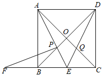

# Mathematics - 题目 1936

**ID**: 0e61904aee564b71b8eee435e687fbd0
**年级**: Grade 9
**难度**: Medium-Hard
**题型**: Multiple-choice

## 题目
如图，在正方形ABCD中，点E是边BC的中点，连接AE、DE，分别交BD、AC于点P、Q，过点P作PF⊥AE交CB的延长线于F，下列结论：①∠AED+∠EAC+∠EDB＝90°，②AP＝FP，③AE＝ $\frac {\sqrt {10}}{2}$AO，④若四边形OPEQ的面积为4，则该正方形ABCD的面积为36，⑤CE•EF＝EQ•DE．其中正确的结论有（      ）​​​​​​​‌

## 解答

1. ①正确：如图，连接OE，
2. 
3. ∵四边形ABCD是正方形，
4. ∴AC⊥BD，OA=OC=OB=OD，
5. ∴∠BOC=90°，
6. ∵BE=EC，
7. ∴∠EOB=∠EOC=45°，
8. ∵∠EOB＝∠EDB+∠OED，∠EOC=∠EAC+∠AEO，
9. ∴∠AED+∠EAC+∠EDO=∠EAC+∠AEO+∠OED+∠EDB=90°，故①正确；
10. ②正确：如图，连接AF，
11. 
12. ∵PF⊥AE，
13. ∴∠APF=∠ABF=90°，
14. ∴A，P，B，F四点共圆，
15. ∴∠AFP=∠ABP＝45°，
16. ∴∠PAF=∠PFA＝45°，
17. ∴PA=PF，故②正确；
18. ③正确：设BE=EC=a，则AE＝ $\sqrt {5}$ a，OA＝OC＝OB＝OD＝ $\sqrt {2}$ a，
19. ∴ $\frac {{\rm{A}}{\rm{E}}}{{\rm{A}}{\rm{O}}}{\rm{=}}\frac {\sqrt {5}{\rm{a}}}{\sqrt {2}{\rm{a}}}{\rm{=}}\frac {\sqrt {10}}{2}$ ，即AE＝ $\frac {\sqrt {10}}{2}$ AO，故③正确；
20. ④错误：根据对称性可知， $\mathrm{△}{\rm{O}}{\rm{P}}{\rm{E}}\cong \mathrm{△}{\rm{O}}{\rm{Q}}{\rm{E}}$ ，
21. ∴ ${\rm{S}}{{}_{\mathrm{△}{\rm{O}}{\rm{E}}{\rm{Q}}}}$ = $\frac {1}{2}$  ${\rm{S}}{{}_{四边形{\rm{O}}{\rm{P}}{\rm{E}}{\rm{Q}}}}$ =2，
22. ∵OB=OD，BE=EC，
23. ∴CD=2OE，OE⊥CD，
24. ∴   $\frac {{\rm{E}}{\rm{Q}}}{{\rm{D}}{\rm{Q}}}{\rm{=}}\frac {{\rm{O}}{\rm{E}}}{{\rm{C}}{\rm{D}}}{\rm{=}}\frac {1}{2}$ ，$\mathrm{△}{\rm{O}}{\rm{E}}{\rm{Q}}\sim \mathrm{△}{\rm{C}}{\rm{D}}{\rm{Q}}$ ，
25. ∴ ${\rm{S}}{{}_{\mathrm{△}{\rm{O}}{\rm{D}}{\rm{Q}}}}{\rm{=}}{\rm{4}}$ ，  ${\rm{S}}{{}_{\mathrm{△}{\rm{C}}{\rm{D}}{\rm{Q}}}}{\rm{=}}8$ ，
26. ∴ ${\rm{S}}{{}_{\mathrm{△}{\rm{C}}{\rm{D}}{\rm{O}}}}{\rm{=}}12$ ，
27. ∴ ${\rm{S}}{{}_{正方形{\rm{A}}{\rm{B}}{\rm{C}}{\rm{D}}}}{\rm{=}}48$ ，故④错误；
28. ⑤正确：∵∠EPF=∠DCE=90°，∠PEF=∠DEC，
29. ∴ $\mathrm{△}{\rm{E}}{\rm{P}}{\rm{F}}\sim \mathrm{△}{\rm{E}}{\rm{C}}{\rm{D}}$ ，
30. ∴ $\frac {{\rm{E}}{\rm{F}}}{{\rm{E}}{\rm{D}}}{\rm{=}}\frac {{\rm{P}}{\rm{E}}}{{\rm{E}}{\rm{C}}}$ ，
31. ∴EQ=PE，
32. ∴CE•EF=EQ•DE，故⑤正确；
33. 综上所诉一共有4个正确，故选：B．

## 知识点

**中文**:
  - 切线长定理

**English**:
  - Tangent Length Theorem

---
