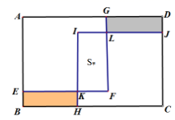

# Mathematics - 题目 1493

**ID**: 0ea4b353ab8e4f6a9ed03bfd14df1c61
**年级**: Grade 9
**难度**: Medium-Hard
**题型**: Multiple-choice

## 题目
如图所示，在矩形 $ABCD$ 内放置两个边长都为 $a$ 的正方形 $AEFG$ 与正方形 $CHIJ$ ，若如图两个正方形重叠部分面积为 $S{{}_{甲}}$ ，矩形 $ABCD$ 未被两个正方形盖住部分面积之和为 $S{{}_{乙}}$ （阴影部分的面积之和），已知： $S{{}_{甲}}{\rm{=}}S{{}_{乙}}$ ，则正方形 $AEFG$ 与矩形 $ABCD$ 的面积之比为（      ）​​​​​​​‌

## 解答

1. 解：设 $AE=m,AB=b,AD=a$ ，由题意可知，三个图形均为矩形，
2. 则 $BE=b-m,\quad BH=a-m$ ， $IK=2m-b,KF=2m-a$ ，
3. ∴ $S{{}_{甲}}=(2m-b)(2m-a)=4m{^{2}}-2am-2bm+ab$ ，
4. ∵两个阴影的矩形的面积一样，
5. ∴ $S{{}_{乙}}=2(b-m)(a-m)=2\left ({ab-am-bm+m{^{2}}}\right )=2ab-2am-2bm+2m{^{2}}$ ，
6. ∵ $S{{}_{甲}}=S{{}_{乙}}$ ，
7. ∴ $4m{^{2}}-2am-2bm+ab$ = $2ab-2am-2bm+2m{^{2}}$ ，
8. ∴ $2m{^{2}}=ab$
9. ∵ $S{{}_{正AEFG}}=m{^{2}}$ ， $S{{}_{矩ABCD}}=ab$ ，
10. ∴ $\frac {S{{}_{正AEFG}}}{S{{}_{矩ABCD}}}=\frac {1}{2}$ ，
11. 故选：A．

## 知识点

**中文**:
  - 正方形的性质
  - 矩形的性质

**English**:
  - Properties of Squares
  - Properties of Rectangles

---
