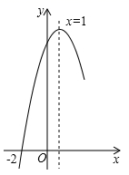

# Mathematics - 题目 3352

**ID**: 0ee69e40c0034f029c9d7985a80127ea
**年级**: Grade 9
**难度**: Medium-Hard
**题型**: Multiple-choice

## 题目
抛物线y＝ax^{2}＋bx＋c经过点（－2，0），且对称轴为直线x＝1，其部分图象如图所示．对于此抛物线有如下四个结论：①b＝2a；​​​​​​​‌②4a＋2b＋c＞0；③若n＞m＞0，则x＝1＋m时的函数值小于x＝1－n时的函数值；④点 $\begin{pmatrix}-\frac {c}{2a},0\end{pmatrix}$ 一定在此抛物线上．其中正确结论的个数是（      ）

## 解答

1. 解：由抛物线y＝ax^{2}＋bx＋c经过点（－2，0），且对称轴为直线x＝1，可得：
2. $x=-\frac {b}{2a}=1$ ， $a<0,b>0,c>0$ ，
3. ∴ $b=-2a$ ，故①错误；
4. ∴根据抛物线的对称性可得与x轴的另一个交点坐标为 $\begin{pmatrix}4,0\end{pmatrix}$ ，
5. ∴当x=2时，则有 $y=4a+2b+c$ ，
6. ∵当x⩾1时，y随x的增大而减小，
7. ∴ $4a+2b+c>0$ ，故②正确；
8. ∵抛物线开口向下，对称轴为直线x=1，
9. ∴横坐标是1-n的点的对称点的横坐标为1+n，
10. 若n＞m＞0，
11. ∴1+n＞1+m，
12. ∴x=1+m时的函数值大于x=1-n时的函数值，故③错误；
13. ∵b=-2a，抛物线y＝ax^{2}＋bx＋c经过点（－2，0），
14. ∴ $0=4a+4a+c$ ，即 $c=-8a$ ，
15. ∴ $-\frac {c}{2a}=4$ ，
16. ∴点 $\begin{pmatrix}-\frac {c}{2a},0\end{pmatrix}$ 一定在此抛物线上，故④正确；
17. 故选C．

## 知识点

**中文**:
  - 二次函数的图象与系数之间的关系

**English**:
  - Relationship between Graphs and Coefficients

---
