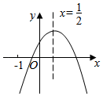

# Mathematics - 题目 332

**ID**: 11555760637146e4ac0661c88eae798b
**年级**: Grade 9
**难度**: Medium-Hard
**题型**: Multiple-choice

## 题目
二次函数y＝ax^{2}+bx+c的图象如图所示，反比例函数y＝ $\frac {ab}{x}$ 与正比例函数y＝（2a+c）x在同一坐标系内的大致图象是（      ）​​​​​​​‌

## 解答

1. 解：∵抛物线开口向下，
2. ∴a＜0，
3. ∵ $-\frac {b}{2a}=\frac {1}{2}$ ，
4. ∴b＝﹣a＞0，
5. ∴ab＜0，反比例函数y＝ $\frac {ab}{x}$ 在第二、四象限，
6. ∵当x＝﹣1时，y＜0，即a-b+c＜0，
7. 把b＝﹣a代入得，2a+c＜0，
8. ∴正比例函数y＝（2a+c）x的图象经过原点，且在第二、四象限，
9. 故选：B．

## 知识点

**中文**:
  - 二次函数的图象与系数之间的关系
  - 正比例函数图象和性质
  - 反比例函数的图象

**English**:
  - Relationship between Graphs and Coefficients
  - Graphs and Properties of Direct Proportion Functions
  - Graph of Inverse Proportionality Functions

---
