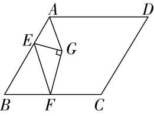

# Mathematics - 题目 2524

**ID**: 1642c301740f43deaae6b553723b9a45
**年级**: Grade 9
**难度**: Medium-Hard
**题型**: Multiple-choice

## 题目
如图，菱形 $ABCD$ 中， $\mathrm{\angle }B={60}^{\circ }$  ，点 $E$ 是 $AB$ 边上的点， $AE=4$ ， $BE=8$ ，点 $F$ 是 $BC$ 上的一点， $△EGF$ 是以点 $G$ 为直角顶点， $\mathrm{\angle }EFG$ 为 ${30}^{\circ }$  角的直角三角形，连接 $AG$ .​​​​​​​‌当点 $F$ 在直线 $BC$ 上运动时，线段 $AG$ 的最小值是（      ）

## 解答

1. 如图，过 $E$ 作 $EQ//BC$ ，过 $A$ 作 $AB$ 的垂线交 $EQ$ 于点 $Q$ ，则 $\mathrm{\angle }AEQ=\mathrm{\angle }B={60}^{\circ }$  ， $\therefore \mathrm{\angle }AQE=\mathrm{\angle }EFG={30}^{\circ }.\because \mathrm{\angle }EGF=\mathrm{\angle }EAQ={90}^{\circ }$  ， $\therefore △AEQ\sim △GEF$ ， $\therefore \frac{AE}{EG}=\frac{EQ}{EF}$ ， $\therefore \frac{AE}{EQ}=\frac{EG}{EF}$ . $\because \mathrm{\angle }AEG=\mathrm{\angle }QEF={60}^{\circ }+\mathrm{\angle }QEG$ ， $\therefore △AEG\sim △QEF$ ，
2. 
3. $\therefore \frac{AG}{QF}=\frac{AE}{QE}=\sin {30}^{\circ }=\frac{1}{2}$ ， $\therefore AG=\frac{1}{2}QF$ .过 $E$ 作 $EH\perp BC$ 于点 $H$ ，则 $EH=BE\cdot \sin {60}^{\circ }=4\sqrt{3}$ . $\because $  点 $F$ 是 $BC$ 上的一点， $\therefore QF\perp BC$ 时 $QF$ 最小，此时 $QF=EH=4\sqrt{3}$ ， $\therefore AG$ 的最小值为 $\frac{1}{2}QF=2\sqrt{3}$ .

## 知识点

**中文**:
  - 矩形的判定与性质综合
  - 菱形的性质
  - 解直角三角形

**English**:
  - Determination and Properties of Rectangles
  - Properties of Rhombuses
  - Solving Right Triangles

---
