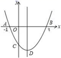

# Mathematics - 题目 1744

**ID**: 1cc563bd6e1245cabe516c683f286901
**年级**: Grade 9
**难度**: Medium-Hard
**题型**: Multiple-choice

## 题目
抛物线y=ax^{2}+bx+c交x轴于A（﹣1,0），B（3,0），交y轴的负半轴于C,顶点为D．下列结论：①2a+b=0；②2c＜3b；③当m≠1时,a+b＜am^{2}+bm；④当△ABD是等腰直角三角形时，则a=0.​​​​​​​‌5；⑤当△ABC是等腰三角形时,a的值有3个.其中正确的有（      ）

## 解答

1. 解：根据A（﹣1,0），B（3,0）可知， $-\frac {b}{2a}=1\Rightarrow 2a+b=0$ ，①正确；
2. $2a-2b+2c=0\Rightarrow 2c=3b$ ，②错误；
3. 当m≠1时，a+b+c＜am^{2}+bm+c  $\Rightarrow $  a+b＜am^{2}+bm，③正确；
4. 当△ABD是等腰直角三角形时，则 $D(1，-2)$
5. $\{\hspace{-0.5em}\begin{array}{l}a-2a+c=-2\\a+2a+c=0\end{array}\hspace{-0.5em}\Rightarrow \{\hspace{-0.5em}\begin{array}{l}c-a=-2\\c+3a=0\end{array}\hspace{-0.5em}\Rightarrow a=0.5$ ， ④正确；
6. 
7. 当△ABC是等腰三角形时,c的值有2个,a的值对应有2个，⑤错误．
8. 故选A．

## 知识点

**中文**:
  - 二次函数的图象与系数之间的关系

**English**:
  - Relationship between Graphs and Coefficients

---
