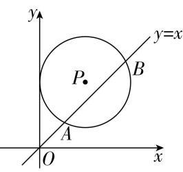

# Mathematics - 题目 3493

**ID**: 1d1ae8992dbe4c72b73d5f1362e6dc1a
**年级**: Grade 9
**难度**: Medium-Hard
**题型**: Multiple-choice

## 题目
［较难］如图，在平面直角坐标系中， $\odot P$ 的圆心坐标是 $(3,a)(a>3)$ ，半径为3，函数 $y=x$ 的图像被 $\odot P$ 截得的弦 $AB$ 的长为 $4\sqrt{2}$ ，则 $a$ 的值是（      ）​​​​​​​‌

## 解答

1. 过点 $P$ 作 $PC\perp x$ 轴于点C，交 $AB$ 于点D，作 $PE\perp AB$ 于点 $E$ ，连接 $PB$ ，如图. $\because \odot P$ 的圆心坐标是 $(3,a)$ ， $\therefore OC=3$ ， $PC=a$ .把 $x=3$ 代入 $y=x$ 得 $y=3$ ， $\therefore $  点D的坐标为 $(3,3)$ ， $\therefore CD=3$ ， $\therefore △OCD$ 为等腰直角三角形， $\therefore △PED$ 也为等腰直角三角形. $\because PE\perp AB$ ， $\therefore AE=BE=\frac{1}{2}AB=2\sqrt{2}$ .在 $\mathrm{R}\mathrm{t}△PBE$ 中， $PB=3$ ， $\therefore PE=\sqrt{P{B}^{2}-B{E}^{2}}=\sqrt{{3}^{2}-{\left(2\sqrt{2}\right)^{2}}}=1$ ， $\therefore PD=\sqrt{P{E}^{2}+D{E}^{2}}=\sqrt{2}PE=\sqrt{2}$ ， $\therefore a=3+\sqrt{2}$ .故选D.
2. 

## 知识点

**中文**:
  - 垂径定理及其推论

**English**:
  - Perpendicular Chord Theorem

---
