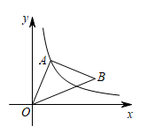

# Mathematics - 题目 3150

**ID**: 21780e29abe3403ca42501e5b0f23d6e
**年级**: Grade 9
**难度**: Medium-Hard
**题型**: Multiple-choice

## 题目
如图，点A在反比例函数 $y=\frac {2}{x}\left ({x>0}\right )$ 的图像上，以 $OA$ 为一边作等腰直角三角形 $OAB$ ，其中∠ $OAB$ =90°， $AO=AB$ ，则线段 $OB$ 长的最小值是（      ）​​​​​​​‌

## 解答

1. 解：如图，过 $A$ 作 $AM{\rm{/\mskip-4mu/}}x$ 轴，交y轴于M，过 $B$ 作 $BD\bot x$ 轴，垂足为D，交MA于H，则 $\angle OMA=\angle AHB=90{}^\circ ,$
2. $\therefore \angle MOA+\angle MAO=90{}^\circ ,$
3. $\because AO=AB,AO\bot AB,$
4. $\therefore \angle MAO+\angle BAH=90{}^\circ ,$
5. $\therefore \angle MOA=\angle BAH,$
6. $\therefore \vartriangle AOM≌\vartriangle BAH,$
7. $\therefore OM=AH,AM=BH,$
8. 设 $A\left ({m,\frac {2}{m}}\right ),$  则 $AM=m,OM=\frac {2}{m},MH=m+\frac {2}{m},BD=\frac {2}{m}-m,$
9. $\therefore $   $B\left ({m+\frac {2}{m},\frac {2}{m}-m}\right ),$
10. $\therefore OB=\sqrt {{\left({m+\frac {2}{m}}\right)^{2}}+{\left({\frac {2}{m}-m}\right)^{2}}}=\sqrt {2m{^{2}}+\frac {8}{m{^{2}}}},$
11. $\because m>0,$  而当 $a>0,b>0$ 时，则 $a+b\geqslant 2\sqrt {ab},$
12. $\therefore 2m{^{2}}+\frac {8}{m{^{2}}}\geqslant 2\sqrt {2m{^{2}}\times \frac {8}{m{^{2}}}}=8,$
13. ∴ $2m{^{2}}+\frac {8}{m{^{2}}}$ 的最小值是8，
14. ∴ $OB$ 的最小值是 $\sqrt {8}=2\sqrt {2}.$
15. 故选：C．
16. 

## 知识点

**中文**:
  - 二次根式的性质和化简
  - 反比例函数系数k的几何意义及应用
  - 等腰三角形的性质
  - 全等三角形的判定与性质

**English**:
  - Properties and Simplification of Secondary Radicals
  - Geometric Meaning and Application of Coefficient k
  - Properties of Isosceles Triangles
  - Determination and Properties

---
