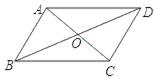

# Mathematics - 题目 1513

**ID**: 26ac2d1e2f5d459fbcd87b08facb4f84
**年级**: Grade 9
**难度**: Medium-Hard
**题型**: Multiple-choice

## 题目
如图，平行四边形ABCD的对角线BD＝6cm，若将平行四边形ABCD绕其对称中心O旋转180°，则点D在旋转过程中所经过的路径长为（      ）​​​​​​​‌

## 解答

1. ∵四边形ABCD为平行四边形，
2. ∴OB＝OD＝3，
3. ∵平行四边形ABCD绕其对称中心O旋转180°，
4. ∴点D在旋转过程中所经过的路径为以O点为圆心，OD为半径，圆心角为180的弧，
5. ∴点D在旋转过程中所经过的路径长＝ $\frac {180\cdot {\rm{π}}\cdot 3}{180}$ ＝3π（cm）．
6. 故选A．

## 知识点

**中文**:
  - 图形的变化

**English**:
  - Transformations of Shapes

---
