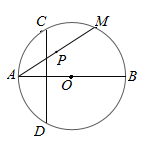

# Mathematics - 题目 2094

**ID**: 2b5d051bd4604e23ba2f75242a56bd0d
**年级**: Grade 9
**难度**: Medium-Hard
**题型**: Multiple-choice

## 题目
如图， $\odot O$ 的直径 $AB=12$ ，弦 $CD$ 垂直平分半径 $OA$ ，动点 $M$ 从点 $C$ 出发在优弧 $CBD$ 上运动到点 $D$ 停止，在点 $M$ 整个运动过程中，线段 $AM$ 的中点 $P$ 的运动路径长为（      ）​​​​​​​‌

## 解答

1. 解：如图，连接OC，设CD交AB于点E．
2. 
3. ∵CD垂直平分线段OA，
4. ∴CA=CO，
5. ∵OC=OA，
6. ∴AC=OC=OA，
7. ∴△AOC是等边三角形，
8. ∴∠CAE=60°，
9. 当点M与C重合时，连接PE，OP，
10. ∵PA=PM，
11. ∴OP⊥AM，
12. ∴∠APO=90°，
13. ∵AE=EO，
14. ∴EP= $\frac {1}{2}$OA=3，
15. ∵PE=AE=3，∠PAE=60°，
16. ∴△PAE是等边三角形，
17. ∴∠AEP=60°；
18. 在点M整个运动过程中，如下图，
19. 
20. ∵点P是AM的中点，点E是AO的中点，
21. ∴ ${\rm PE=\frac {1}{2}OM=\frac {1}{2}OA=AE=EO}$ ，
22. ∴线段AM的中点P的运动轨迹是图中 ${\rm \overset ⌢{{IOJ}}}$ ，
23. ∵ ${\rm \angle IEJ=2\times 60{}^\circ =120{}^\circ}$ ，
24. ∴ ${\rm \overset ⌢{{IOJ}}}$ 的圆心角 $=360{}^\circ -120{}^\circ =240{}^\circ $ ，
25. ∴运动路径的长= $\frac {240π\cdot 3}{180}=4π$ ．
26. 故选：B．

## 知识点

**中文**:
  - 弧长公式
  - 等边三角形的判定与性质
  - 线段垂直平分线的性质

**English**:
  - Arc Length Formula
  - Determination and Properties
  - Properties of Perpendicular Bisectors

---
