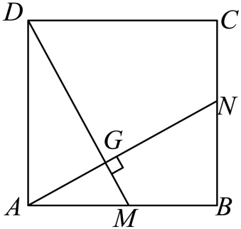

# Mathematics - 题目 3689

**ID**: 2bd62e5d626649b2ba0d0dd5ae1aa154
**年级**: Grade 9
**难度**: Medium-Hard
**题型**: Multiple-choice

## 题目
如图，在正方形 $ABCD$ 中， $AB=4,AN\bot DM$ ．则下列结论：① $\mathrm{△}DAG∽\mathrm{△}ANB$ ；​​​​​​​‌② $S{{}_{\mathrm{△}ADG}}=S{{}_{四边形BMGN}}$ ；③连接 $MN,DN$ ，若 $\vartriangle DMN$ 的面积为 $\frac {13}{2}$ ，则 $AN$ 的长为5．其中正确的结论是（      ）

## 解答

1. 提示： $\because$ 四边形 $ABCD$ 是正方形，
2. $\therefore \angle DAB=\angle B=90{}^\circ$ ．
3. $\because AN\bot DM$ ，即 $\angle AGD=90{}^\circ$ ，
4. $\therefore \angle GAM+\angle GAD=90{}^\circ =\angle GAD+\angle GDA$ ，
5. $\therefore \angle ADG=\angle BAN$ ，
6. $\therefore \mathrm{△}DAG∽\mathrm{△}ANB$ ，故①正确；
7. 在 $\vartriangle ABN$ 与 $\mathrm{△}DAM$ 中，
8. $\begin{cases}\angle BAN=\angle ADM\\AB=DA\\\angle B=\angle DAM\end{cases}$ ,
9. $\therefore \mathrm{△}ABN\mathrm{≌}\mathrm{△}DAM\left ({{\rm{A}}{\rm{S}}{\rm{A}}}\right )$ ，
10. $\therefore S{{}_{\mathrm{△}ADG}}=S{{}_{四边形BMGN}}$ ，故②正确；
11. 设 $AM=BN=x$ ，则 $BM=CN=4-x$ ，
12. $\therefore S{{}_{\mathrm{△}DMN}}=S{{}_{正方形ABCD}}-S{{}_{\mathrm{△}ADM}}-S{{}_{\mathrm{△}MBN}}-S{{}_{\mathrm{△}DCN}}$
13. $=4\times 4-\frac {1}{2}\times 4x-\frac {1}{2}x\left ({4-x}\right )-\frac {1}{2}\times 4\left ({4-x}\right )$
14. $=16-2x-2x+\frac {1}{2}x{^{2}}-8+2x$
15. $=\frac {1}{2}x{^{2}}-2x+8$ ，
16. $\therefore \frac {1}{2}x{^{2}}-2x+8=\frac {13}{2}$ ，解得 $x=3$ 或 $x=1$ ，
17. $\therefore BN=3$ 或 $BN=1$ ．
18. $\because AN{^{2}}=AB{^{2}}+BN{^{2}}$ ，
19. $\therefore AN=5$ 或 $AN=\sqrt {17}$ ，故③错误．
20. 故此题答案为A．

## 知识点

**中文**:
  - 因式分解法解一元二次方程
  - 正方形的性质
  - 相似三角形的判定与性质综合

**English**:
  - Solving by Factorization
  - Properties of Squares
  - Determination and Properties

---
