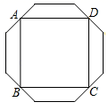

# Mathematics - 题目 599

**ID**: 2ea2805b483e495ca0b14da15a4281f7
**年级**: Grade 9
**难度**: Medium-Hard
**题型**: Multiple-choice

## 题目
如图，正八边形各边中点构成四边形，则正八边形边长与AB的比是（      ）​​​​​​​‌

## 解答

1. 过E作EF⊥AD于F，过G作GH⊥AD于H，
2. 
3. 则△AEF与△DGH是等腰直角三角形，四边形EFHG是矩形，
4. ∴AF＝EF＝DH＝GH，EG＝FH，
5. 设AF＝EF＝GH＝DH＝k，
6. ∴AE＝DG＝ $\sqrt {2}$k，
7. ∴EG＝2AE＝2 $\sqrt {2}$k，
8. ∴AB＝AD＝2 $\sqrt {2}$k+2k，
9. ∴正八边形边长与AB的比＝ $\frac {2\sqrt {2}{\rm{k}}}{2\sqrt {2}{\rm{k}}+2{\rm{k}}}=2-\sqrt {2}$ ，
10. 故选A．

## 知识点

**中文**:
  - 正多边形和圆

**English**:
  - Regular Polygons and Circles

---
