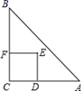
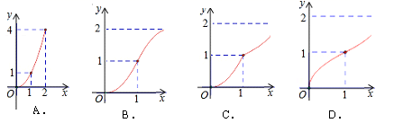

# Mathematics - 题目 409

**ID**: 2f66eae5b73d4d55a0285a7d7c66635c
**年级**: Grade 9
**难度**: Medium-Hard
**题型**: Multiple-choice

## 题目
如图，Rt△ABC中，AC=BC=2，正方形CDEF的顶点D、F分别在AC、BC边上，C、D两点不重合，设CD的长度为x，△ABC与正方形CDEF重叠部分的面积为y，则下列图象中能表示y与x之间的函数关系的是（      ）​​​​​​​‌

## 解答

1. 解：当0＜x⩽1时，y=x^{2}，
2. 当1＜x⩽2时，ED交AB于M，EF交AB于N，如图，
3. 
4. CD=x，则AD=2-x，
5. ∵Rt△ABC中，AC=BC=2，
6. ∴△ADM为等腰直角三角形，
7. ∴DM=2-x，
8. ∴EM=x-（2-x）=2x-2，
9. ∴S_{△ENM}= $\frac {1}{2}$ （2x-2）^{2}=2（x-1）^{2}，
10. ∴y=x^{2}-2（x-1）^{2}=-x^{2}+4x-2=-（x-2）^{2}+2，
11. ∴y= $\begin{cases}x{^{2}}，(0＜x\leqslant 1)\\-{\left({x-2}\right)^{2}}+2，(1＜x\leqslant 2)\end{cases}$ ．
12. 故选B．

## 知识点

**中文**:
  - 动点问题的函数图象

**English**:
  - Graphs of Moving Point Problems

---
