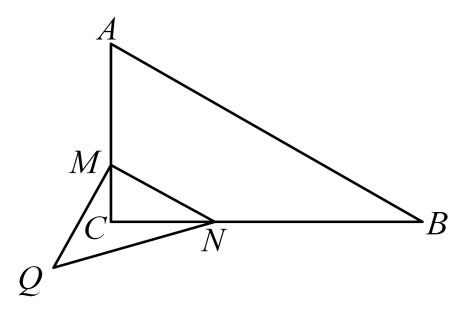

# Mathematics - 题目 2040

**ID**: 47adf43b78204935ab477cfc8928f1aa
**年级**: Grade 9
**难度**: Medium-Hard
**题型**: Multiple-choice

## 题目
如图，在 $\vartriangle ABC$ 中， $\angle ACB\mathrm{=}90{}\degree $ ， $\angle ABC=30{}\degree $ ， $AC=1$ ，点N是 $BC$ 边上的一点，且  $\frac {BN}{CN}=2$ ，点M是 $AC$ 边上一个动点，连接 $MN$ ，以 $MN$ 为直角边，点M为直角顶点，在 $MN$ 的左侧作等腰直角三角形 $MNQ$ ，则 $CQ$ 的最小值是 （      ）​​​​​​​‌

## 解答

1. 解：∵ $\angle ACB\mathrm{=}90{}\degree $ ， $\angle ABC=30{}\degree $ ， $AC=1$ ，点N是 $BC$ 边上的一点，且  $\frac {BN}{CN}=2$ ，
2. ∴ $AB=2$ ， $BC=\frac {AC}{{\tan}30{}\degree }=\sqrt {3}$ ， $CN=\frac {\sqrt {3}}{3}$ ，
3. 如图，在 $CN$ 的下方作等腰直角 $\vartriangle CNT$ ，作射线 $TQ$ ，交 $BC$ 的延长线于 $G$ ．
4. 
5. ∴ $\frac {CN}{TN}=\frac {\sqrt {2}}{2}$ ， $\angle CNT=\angle CTN=45{}\degree $ ，
6. ∵等腰直角三角形 $MNQ$ ，
7. ∴ $\frac {MN}{NQ}=\frac {\sqrt {2}}{2}$ ， $\angle MNQ=45{}\degree $ ，
8. ∴ $\angle MNC=\angle QNT$ ，
9. ∴ $\mathrm{△}MNC∽\mathrm{△}QNT$ ，
10. ∴ $\angle MCN=\angle QTN=90{}\degree $ ，
11. ∴ $\angle CTQ=45{}\degree $ ，
12. ∴ $Q$ 在射线 $TQ$ 上，
13. ∴当 $CQ\bot TQ$ 时， $CQ$ 最短，
14. ∵ $\angle ACB=90{}\degree =\angle TCN=\angle TCG$ ，
15. ∴ $CN=CT=TG=\frac {\sqrt {3}}{3}$ ，
16. ∴ $GT=NT=\frac {\sqrt {3}}{3}\times \sqrt {2}=\frac {\sqrt {6}}{3}$ ，
17. ∴ $CQ=\frac {1}{2}GT=\frac {\sqrt {6}}{6}$ ，
18. 故此题答案为B.

## 知识点

**中文**:
  - 最短路径问题
  - 相似三角形的判定与性质综合
  - 解直角三角形
  - 等腰直角三角形的性质

**English**:
  - Shortest Path Problems
  - Determination and Properties
  - Solving Right Triangles
  - Properties of Isosceles Right Triangles

---
