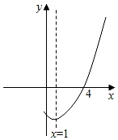

# Mathematics - 题目 1671

**ID**: 494df207593f4f439a9bb2204b925864
**年级**: Grade 9
**难度**: Medium-Hard
**题型**: Multiple-choice

## 题目
如图，抛物线y＝ax^{2}+bx+c（a≠0）与x轴交于点（4，0），其对称轴为直线x＝1，结合图象给出下列结论：①ac＜0；​​​​​​​‌②4a﹣2b+c＞0；③当x＞2时，y随x的增大而增大；④关于x的一元二次方程ax^{2}+bx+c＝0有两个不相等的实数根．其中正确的结论有（      ）

## 解答

1. 解：抛物线开口向上，因此a＞0，与y轴交于负半轴，因此c＜0，故ac＜0，所以①正确；
2. 抛物线对称轴为x＝1，与x轴的一个交点为（4，0），则另一个交点为（﹣2，0），于是有4a﹣2b+c＝0，所以②不正确；
3. x＞1时，y随x的增大而增大，所以③正确；
4. 抛物线与x轴有两个不同交点，因此关于x的一元二次方程ax^{2}+bx+c＝0有两个不相等的实数根，所以④正确；
5. 综上所述，正确的结论有：①③④，
6. 故选：C．

## 知识点

**中文**:
  - 二次函数的图象与系数之间的关系

**English**:
  - Relationship between Graphs and Coefficients

---
