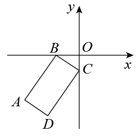

# Mathematics - 题目 2203

**ID**: 4c46729b50de4ad59447cebdff93687a
**年级**: Grade 9
**难度**: Medium-Hard
**题型**: Multiple-choice

## 题目
如图，矩形ABCD的顶点B，C分别在x轴，y轴上，OB＝4，OC＝3，AB＝10，将矩形ABCD绕点O顺时针旋转，每次旋转90°，则第2021次旋转结束时，点A的坐标为（      ）​​​​​​​‌

## 解答

1. 解：过点A作AE⊥x轴于点E，连接OA．
2. 
3. ∵OB＝4，OC＝3，
4. ∴BC＝ $\sqrt {OB{^{2}}+OC{^{2}}}$ ＝ $\sqrt {4{^{2}}+3{^{2}}}$ ＝5，
5. ∵∠AEB＝∠ABC＝∠BOC＝90°，
6. ∴∠ABE＋∠CBO＝90°，∠CBO＋∠BCO＝90°，
7. ∴∠ABE＝∠BCO，
8. ∴△AEB∽△BOC，
9. ∴ ${\rm \frac {AB}{BC}=\frac {AE}{OB}=\frac {BE}{OC}}$ ，
10. ∴ ${\rm \frac {10}{5}=\frac {AE}{4}=\frac {BE}{3}}$ ，
11. ∴AE＝8，BE＝6，
12. ∴OE＝10，
13. ∴A（−10，−8），
14. 则第1次旋转结束时，点A的坐标为（−8，10），
15. 则第2次旋转结束时，点A的坐标为（10，8），
16. 则第3次旋转结束时，点A的坐标为（8，−10），
17. 则第4次旋转结束时，点A的坐标为（−10，−8），
18. ……
19. 观察可知，4次一个循环，
20. ∵2021÷4＝505...1，
21. ∴第2021次旋转结束时，点A的坐标为（−8，10），
22. 故选：D．

## 知识点

**中文**:
  - 坐标与图形变换——旋转
  - 规律型：图形的变化类

**English**:
  - Coordinates and Rotation
  - Patterns: Geometric Variations

---
