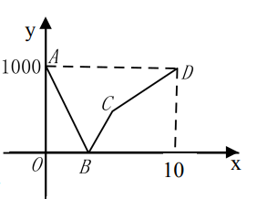

# Mathematics - 题目 3693

**ID**: 539165f47bcc4d50a161f51e6cf2956e
**年级**: Grade 9
**难度**: Medium-Hard
**题型**: Multiple-choice

## 题目
如图，一列快车从甲地驶往乙地，一列慢车从乙地驶往甲地，两车同时出发，设慢车行驶的时间为 $x\left ({h}\right ),$ 两车之间的距离为 $y\left ({km}\right )$ ，图中的折线表示 $y$ 与 $x$ 之间的函数关系，下列说法中错误的是（      ）​​​​​​​‌

## 解答

1. 由图形得，甲乙两地相距1000km，A正确
2. 慢车共行驶了10h，速度为100km/h，C正确
3. 根据分析，点B处表示两车相遇，B正确
4. 折线B-C-D表示的是两车运动的状态，而非速度变化，D错误
5. 故选：D

## 知识点

**中文**:
  - 行程问题

**English**:
  - Distance-Speed-Time Problems

---
