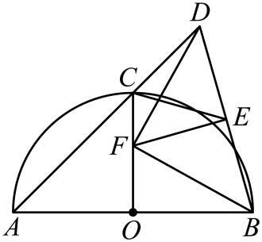

# Mathematics - 题目 646

**ID**: 53f703d46c89406283cd0082e063dfb3
**年级**: Grade 9
**难度**: Medium-Hard
**题型**: Multiple-choice

## 题目
如图， $AB$ 为 $\odot O$ 的直径， $AB=2$ ， $C$ 为 $\overset{\frown}{{AB}}$ 的中点，连接 $OC$ ，点 $D$ 在射线 $AC$ 上，连接 $BD$ ，取 $BD$ 的中点 $E$ ，过 $E$ 作 $EF\bot BD$ 交 $OC$ 于 $F$ ，连接 $CE$ ．下列结论：① $DF\bot BF$ ；​​​​​​​‌② $EC=EF$ ；③ $∠OFB=∠ADB$ ；④ $DC+\sqrt {2}CF$ 为定值 $2$ ．其中正确结论的个数为（      ）

## 解答

1. 解：连接 $AF$ ，
2. 
3. ∵ $E$ 是 $BD$ 中点， $EF\bot BD$ ，
4. ∴ $EF$ 垂直平分 $BD$ ，
5. ∴ $FB=FD$ ．
6. ∵ $OC$ 是半径， $C$ 为 $\overset{\frown}{{AB}}$ 的中点，
7. ∴ $OC\bot AB$ ，
8. ∵ $OA=OC=OB$ ，
9. ∴ $∠BOC=∠AOC=90{}\degree $ ， $\vartriangle AOC$ 是等腰直角三角形， $FA=FB=FD$ ，
10. ∴ $∠BAC=∠OCA=45{}\degree $ ，点 $A$ ， $B$ ， $D$ 以 $F$ 为圆心的圆上，
11. ∴ $∠BFD=2∠BAC=90{}\degree $ ，
12. ∴ $DF\bot BF$ ，①正确．
13. 连接 $BC$ ，
14. 
15. ∵ $AB$ 是半 $\odot O$ 的直径，
16. ∴ $∠ACB=90{^{\circ }}=∠BCD=∠BFD,$
17. ∴点 $C$ 和点 $F$ 在以点 $E$ 为圆心的同一个圆上，
18. ∴ $EC=EF$ ，故②正确．
19. 连接 $AF$ ，
20. 
21. ∴①知点 $A$ ， $B$ ， $D$ 以 $F$ 为圆心的圆上，
22. ∴ $∠ADB=\frac {1}{2}∠AFB=∠BFO$ ，故③正确．
23. 在直角 $\vartriangle BDC$ 中，
24. $DC=BD{\rm{c}}{\rm{o}}{\rm{s}}∠BDC=\sqrt {2}BF\cdot {\rm{c}}{\rm{o}}{\rm{s}}∠BEO=\sqrt {2}BF\cdot \frac {BF}{OF}=\sqrt {2}OF$ ，
25. ∴ $DC+\sqrt {2}CF=\sqrt {2}OF+\sqrt {2}CF=\sqrt {2}\left ({OF+CF}\right )=\sqrt {2}OC=\sqrt {2}$ ，故④错误．
26. 

## 知识点

**中文**:
  - 半圆（或直径）所对的圆周角是直角
  - 解直角三角形
  - 圆周角定理

**English**:
  - Angle in a Semicircle is Right
  - Solving Right Triangles
  - Inscribed Angle Theorem

---
