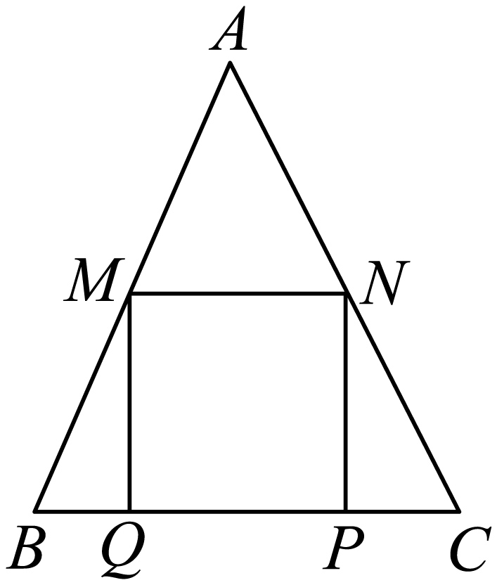

# Mathematics - 题目 322

**ID**: 5919389de5df47ddabdf138eb845644f
**年级**: Grade 9
**难度**: Medium-Hard
**题型**: Multiple-choice

## 题目
如图，锐角 $ΔABC$ 中， $BC=6$ ， $S{{}_{\Delta ABC}}=12$ ，两动点 $M$ 、 $\mathbf{N}$ 分别在边 $AB$ 、 $AC$ 上滑动，且 $MN//{\rm BC}$ ，以 $MN$ 为边向作正方形 $MPQN$ ，设其边长为 $x$ ，正方形 $MPQN$ 与 $ΔABC$ 公共部分的面积为 $y$ ，则 $y$ 与 $x$ 的函数图象大致是（      ）​​​​​​​‌

## 解答

1. 如图，过点 $A$ 作 $AD⊥BC$ 于点 $D$ ，
2. $\because BC=6$ ， $S{{}_{\Delta ABC}}=12$ ，
3. $\therefore \frac {1}{2}BC\cdot AD=12$ ，
4. 解得 $AD=4$ ，
5. 方法一：当 $PQ$ 在 $BC$ 边上时，则 $\vartriangle AMN$ 的 $MN$ 边上的高为 $4-x$ ，
6. $\because MN{\rm{/}}{\rm{/}}BC$ ，
7. $\therefore \frac {MN}{BC}=\frac {4-x}{AD}$ ，即 $\frac {x}{6}=\frac {4-x}{4}$ ，
8. 解得 $x=2.4$ ，
9. 由题意，分以下两种情况：
10. ①当公共部分全在 $\vartriangle ABC$ 内，即 $0<x\leqslant 2.4$ 时，
11. 则 $y=x{^{2}}$ ；
12. ②当公共部分的一部分在 $\vartriangle ABC$ 内，另一部分在 $\vartriangle ABC$ 外，即 $2.4<x\leqslant 6$ 时，
13. 如图，设 $AD$ 交 $MN$ 于 $E$ 点，且 $DE=a$ ，则 $AE=4-a$ ，
14. $\because MN{\rm{/}}{\rm{/}}BC$ ，
15. $\therefore \frac {MN}{BC}=\frac {AE}{AD}$ ，即 $\frac {x}{6}=\frac {4-a}{4}$ ，
16. 解得 $a=4-\frac {2x}{3}$ ，
17. 则 $y=ax=(4-\frac {2x}{3})x=-\frac {2}{3}x{^{2}}+4x$ ，
18. 由此可知， $y$ 与 $x$ 的函数图象大致是选项 $D$ 的图象；
19. 方法二：当 $PQ$ 在 $BC$ 边上时，则 $\vartriangle AMN$ 的 $MN$ 边上的高为 $4-x$ ， $BP+CQ=BC-PQ=6-x$ ，
20. $\because S{{}_{\vartriangle AMN}}+S{{}_{\vartriangle BMP}}+S{{}_{\vartriangle CNQ}}+S{{}_{\square MPQN}}=S{{}_{\vartriangle ABC}}$ ，
21. $\therefore \frac {1}{2}(4-x)\cdot MN+\frac {1}{2}x\cdot BP+\frac {1}{2}x\cdot CQ+x{^{2}}=12$ ，
22. 即 $\frac {1}{2}x(4-x)+\frac {1}{2}x(6-x)+x{^{2}}=12$ ，
23. 解得 $x=2.4$ ，
24. 由题意，分以下两种情况：
25. ①当公共部分全在 $\vartriangle ABC$ 内，即 $0<x\leqslant 2.4$ 时，
26. 则 $y=x{^{2}}$ ；
27. ②当公共部分的一部分在 $\vartriangle ABC$ 内，另一部分在 $\vartriangle ABC$ 外，即 $2.4<x\leqslant 6$ 时，
28. 如图，设 $AD$ 交 $MN$ 于 $E$ 点，且 $DE=a$ ，则 $AE=4-a$ ，
29. $\because S{{}_{\vartriangle AMN}}+S{{}_{\vartriangle BMP}}+S{{}_{\vartriangle CNQ}}+S{{}_{\square MPQN}}=S{{}_{\vartriangle ABC}}$ ，
30. $\therefore \frac {1}{2}x(4-a)+\frac {1}{2}a(6-x)+ax=12$ ，
31. 解得 $a=4-\frac {2x}{3}$ ，
32. 则 $y=ax=(4-\frac {2x}{3})x=-\frac {2}{3}x{^{2}}+4x$ ，
33. 由此可知， $y$ 与 $x$ 的函数图象大致是选项 $D$ 的图象；
34. 故选D．
35. 

## 知识点

**中文**:
  - 图形问题
  - 平行线分线段成比例定理

**English**:
  - Geometric Problems
  - Parallel Lines Intercept Theorem

---
