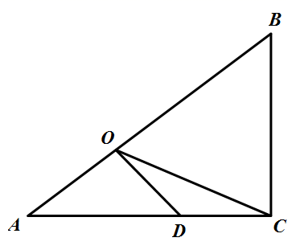

# Mathematics - 题目 333

**ID**: 6139a58fa50b4a3897c8d007e8357899
**年级**: Grade 9
**难度**: Medium-Hard
**题型**: Multiple-choice

## 题目
如图，△ABC中， $\angle ACB=90{^{\circ }}$ ，AB+BC=8，tanA= $\frac {3}{4}$ ，点O，D分别是边AB，AC上的动点，则OC+OD的最小值为（      ）​​​​​​​‌

## 解答

1. 试题分析：如图，作点C关于AB的对称点 $C{{}_{1}}$ ，连接 $CC{{}_{1}}$ ，交AB于点H，则 $OC=OC{{}_{1}}$ ，当点 $C{{}_{1}}$ ，O，D三点共线，并且 $C{{}_{1}}D\bot AC$ 时，OC+OD的值最小，即 $C{{}_{1}}D$ 的长．∵ $\angle ACB=90{^{\circ }}$ ， $CH\bot AB$ ，∴ $5\times CH=3\times 4$ ，∴ $CH=\frac {12}{5}$ ，∴ $CC{{}_{1}}=\frac {24}{5}$ ，∵ $\angle ACB=90{^{\circ }}$ ， $CH\bot AB$ ，∴ $4{^{2}}=AH\cdot 5$ ，∴ $AH=\frac {16}{5}$ ，∴ $4\times C{{}_{1}}D=\frac {24}{5}\times \frac {16}{5}$ ，解得 $C{{}_{1}}D=\frac {96}{25}$ ，故选D．

## 知识点

**中文**:
  - 最短路径问题
  - 解直角三角形

**English**:
  - Shortest Path Problems
  - Solving Right Triangles

---
