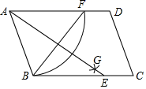

# Mathematics - 题目 3920

**ID**: 619074f807c9489e9f7a67f8b9b5e317
**年级**: Grade 9
**难度**: Medium-Hard
**题型**: Multiple-choice

## 题目
如图，在平行四边形ABCD中，按以下步骤作图：①以A为圆心，AB长为半径画弧，交边AD于点；②再分别以B，F为圆心画弧，两弧交于平行四边形ABCD内部的点G处；③连接AG并延长交BC于点E，连接BF，若BF＝3，AB＝2.​​​​​​​‌5，则AE的长为（      ）

## 解答

1. 由题意得：AF=AB，AE为∠BAD的角平分线，则∠BAE=∠FAE．
2. 又∵四边形ABCD是平行四边形，则AD∥BC，∠BAE=∠FAE=∠BEA，∴AF=AB=BE．
3. 连接EF，则四边形ABEF是菱形，∴AE与BF互相垂直平分，设AE与BF相交于点O，OB$=\frac {BF}{2}=$ 1.5．在Rt△AOB中，OA$=\sqrt {AB{^{2}}-OB{^{2}}}=\sqrt {2．5{^{2}}-1．5{^{2}}}=$ 2，则AE=2OA=4．
4. 
5. 故选B．

## 知识点

**中文**:
  - 菱形的判定与性质综合

**English**:
  - Determination and Properties of Rhombuses

---
