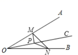

# Mathematics - 题目 2201

**ID**: 6532a35813884c5981e2bba2306dfb22
**年级**: Grade 9
**难度**: Medium-Hard
**题型**: Multiple-choice

## 题目
如图，∠AOB＝30°，OC为∠AOB内部一条射线，点P为射线OC上一点，OP＝6，点M、N分别为OA、OB边上动点，则△MNP周长的最小值为（      ）​​​​​​​‌

## 解答

1. 解：作点P关于OA的对称点P_{1}，点P关于OB的对称点P_{2}，连结P_{1}P_{2}，与0A的交点即为点M，与OB的交点即为点N，
2. 
3. △MNP的最小周长为P．
4. M＋MN＋PN=P_{1}M＋MN＋P_{2}N= P_{1}P_{2}，即为线段P_{1}P_{2}的长，
5. 连结OP_{1}、OP_{2}，则OP_{1}=0P_{2}=6，
6. 又∵∠P_{1}OP_{2}=2∠AOB=60^{。}，
7. ∴△OP_{1}P_{2}是等边三角形，
8. ∴P_{1}P_{2}=OP_{1}=6，
9. 即△MNP的周长的最小值是6．
10. 故选：B．

## 知识点

**中文**:
  - 等边三角形的判定与性质
  - 轴对称的性质

**English**:
  - Determination and Properties
  - Properties of Axial Symmetry

---
