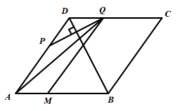

# Mathematics - 题目 878

**ID**: 6b49ae85122649efa4a41a6c891bb5ff
**年级**: Grade 9
**难度**: Medium-Hard
**题型**: Multiple-choice

## 题目
如图， 在边长为 $2cm$ 且一个内角为 $60{^{\circ }}$ 的菱形 $ABCD$ 中， 点 $P$ 以每秒 $1cm$ 的速度从点 $A$ 出发，沿 $AD\to DC$ 的路径运动，到点 $C$ 停止，点 $M$ 也以每秒 $1cm$ 的速度从点A出发，沿 $AB$ 方向运动，到点 $B$ 停止，两点同时出发，过点 $P$ 作 $PQ$ ⊥ $BD$ ， $PQ$ 与边 $CD$ （或边 $AD$ ）交于点 $\mathbf{Q}$ ， $ΔAMQ$ 的面积 $y(cm{^{2}})$ 与点 $P$ 的运动时间 $x$ （秒）的函数图象大致是（      ）​​​​​​​‌

## 解答

1. 解：过点B作BO⊥DC于点O，连接AC，
2. 
3. ∵ $ABCD$ 是边长为 $2cm$ 且一个内角为 $60{^{\circ }}$ 的菱形，
4. ∴以AB为底的菱形的高为BO，
5. ∴ $BO={\sin}60{}^\circ \times BC=\frac {\sqrt {3}}{2}\times 2=\sqrt {3}$  ，
6. 当P点由A出发向D运动，假设运动时间为x， $0<x\leqslant 2$  时，P点由A出发向D运动，
7. ∵点 $M$ 也以每秒 $1cm$ 的速度从点A出发，沿 $AB$ 方向运动，到点 $B$ 停止，
8. ∴ $y=S{{}_{ΔAMQ}}=\frac {1}{2}\times AM\times BO=\frac {\sqrt {3}}{2}AM=\frac {\sqrt {3}}{2}t$ ，
9. ∴当 $0<x\leqslant 2$  时 $ΔAMQ$ 的面积匀速递增，当 $x=2$  时面积达到最大，此时面积为：
10. $y=S{{}_{ΔAMQ}}=\frac {\sqrt {3}}{2}\times 2=\sqrt {3}$ ，故排除A、D；
11. 当P点由D出发向C运动时， $2<x\leqslant 4$  时M点停在B点，
12. 此时Q点在AD上，作QR⊥AB于点R，
13. 
14. 此时 $y=S{{}_{ΔAMQ}}=\frac {1}{2}\times AB\times QM=\frac {1}{2}\times 2\times QM=\sqrt {3}QM=(4-t)\times \frac {\sqrt {3}}{2}=2\sqrt {3}-\frac {\sqrt {3}}{2}t$ ，
15. 故 $ΔAMQ$ 的面积递减且符合一次函数的图像，排除B选C，
16. 故选：C；

## 知识点

**中文**:
  - 动点问题的函数图象
  - 菱形的性质
  - 特殊角的三角函数值

**English**:
  - Graphs of Moving Point Problems
  - Properties of Rhombuses
  - Trigonometric Values of Special Angles

---
