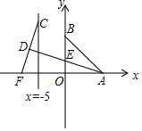

# Mathematics - 题目 3749

**ID**: 6b596412adae4f61b50e15d4d8785c2e
**年级**: Grade 9
**难度**: Medium-Hard
**题型**: Multiple-choice

## 题目
如图，已知 $A、B$  两点的坐标分别为 $\left ({8,0}\right )，\left ({0,8}\right )$ ，点 $C、F$ 分别是直线 $x=-5$ 和x轴上的动点， $CF=10$ ,点 $D$ 是线段 $CF$ 的中点，连接 $AD$ 交 $y$ 轴于点 $E$ ；​​​​​​​‌当⊿ $ABE$ 面积取得最小值时， ${\tan}\angle BAD$ 的值是（      ）

## 解答

1. 如图，设直线x=-5交x轴于K．由题意KD= $\frac {1}{2}$ CF=5，
2. 
3. ∴点D的运动轨迹是以K为圆心，5为半径的圆，
4. ∴当直线AD与⊙K相切时，△ABE的面积最小，
5. ∵AD是切线，点D是切点，
6. ∴AD⊥KD，
7. ∵AK=13，DK=5，
8. ∴AD=12，
9. ∵tan∠EAO= $\frac {OE}{OA}=\frac {DK}{AD}$ ，
10. ∴ $\frac {OE}{8}=\frac {5}{12}$ ，
11. ∴OE= $\frac {10}{3}$ ，
12. ∴AE= $\sqrt {OE{^{2}}+OA{^{2}}}=\frac {26}{3}$ ，
13. 作EH⊥AB于H．
14. ∵S_{△ABE}= $\frac {1}{2}$ •AB•EH=S_{△AOB}-S_{△AOE}，
15. ∴EH= $\frac {7\sqrt {2}}{3}$ ，
16. ∴ $AH=\sqrt {AE{^{2}}-EH{^{2}}}=\frac {17\sqrt {2}}{3}$ ，
17. ∴ ${\tan}\angle BAD=\frac {EH}{AH}=\frac {\frac {7\sqrt {2}}{3}}{\frac {17\sqrt {2}}{3}}=\frac {7}{17}$ ，
18. 故选B.

## 知识点

**中文**:
  - 正切

**English**:
  - Tangent

---
