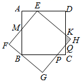

# Mathematics - 题目 1192

**ID**: 6bcf3d4a93e94584a3dbe984f8f73e1f
**年级**: Grade 9
**难度**: Medium-Hard
**题型**: Multiple-choice

## 题目
如图，两个大小相同的正方形 $ABCD$ ， $EFGH$ 如图放置，点 $E$ ， $B$ 分别在边 $AD$ ， $FG$ 上，若要求出阴影部分的周长，只要知道下列哪条线段的长度即可（      ）．​​​​​​​‌

## 解答

1. 解：过B作BN⊥EH，垂足为N，连接BE，BK，KP，
2. ∵两个大小相同的正方形，
3. ∴AB=EF，又∵∠A=∠F，BE=EB，
4. ∴Rt△ABE≌Rt△FEB（HL），
5. ∴∠AEB=∠FBE=∠NEB，AE=BF，
6. 同理可得：Rt△BAE≌Rt△BNE，Rt△BNK≌Rt△BCK，
7. ∴∠EBK=45°，
8. ∴AE+KC=EK，
9. ∵AE=BF，
10. ∴DE=BG，
11. ∵∠H=∠C=90°，∠PQC=∠KQH，
12. ∴∠BPG=∠CPQ=∠QKH=∠EKD，
13. ∴△BGP≌△EDK，
14. ∴PG=KD，
15. ∴PH=KC，
16. 同理可证：△KHP≌△PCK，
17. ∴△KQH的周长为KC+KH，
18. 又∵AE+ED=EK+KH，AE+KC=EK，
19. ∴AE+ED=AE+KC+KH，
20. ∴ED=KC+KH=△KQH的周长，
21. ∴要求出阴影部分的周长，只要知道线段ED的长度，
22. 故选C．
23. 

## 知识点

**中文**:
  - 全等三角形的综合问题
  - 正方形的判定与性质综合

**English**:
  - Comprehensive Problems
  - Determination and Properties of Squares

---
