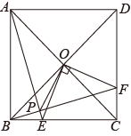

# Mathematics - 题目 1039

**ID**: 6e4bf5dc6403450e9cc3a14ce05aac0c
**年级**: Grade 9
**难度**: Medium-Hard
**题型**: Multiple-choice

## 题目
如图，正方形ABCD的对角线AC，BD相交于点O，点F是CD上一点， $OE\bot OF$ 交BC于点E，连接AE，BF交于点P，连接OP．则下列结论：① $AE\bot BF$ ；​​​​​​​‌② $\angle OPA=45{}^\circ $ ；③ $AP-BP=\sqrt {2}OP$ ；④若 $BE:CE=2:3$ ，则 ${\tan}\angle CAE=\frac {4}{7}$ ；⑤四边形OECF的面积是正方形ABCD面积的 $\frac {1}{4}$ ．其中正确的结论是（      ）

## 解答

1. ①∵四边形ABCD是正方形，O是对角线AC、BD的交点，
2. ∴OC=OD，OC⊥OD，∠ODF=∠OCE=45°
3. ∵ $OE\bot OF$
4. ∴∠DOF+∠FOC=∠FOC+∠EOC=90°
5. ∴∠DOF=∠EOC
6. 在△DOF与△COE中
7. $\begin{cases}\angle ODF=\angle OCE\\OC=OD\\\angle DOF=\angle EOC\end{cases}$
8. ∴ $\vartriangle DOF{\rm{≌}}\vartriangle COE\left ({ASA}\right )$
9. ∴EC=FD
10. ∵在△EAC与△FBD中 $\begin{cases}EC=FD\\\angle ECA=\angle FDB=45{}^\circ \\AC=BD\end{cases}$
11. ∴ $\vartriangle EAC{\rm{≌}}\vartriangle FBD\left ({SAS}\right )$
12. ∴∠EAC=∠FBD
13. 又∵∠BQP=∠AQO
14. ∴∠BPQ=∠AOQ=90°
15. ∴AE⊥BF
16. 所以①正确；
17. ②∵∠AOB=∠APB=90°
18. ∴点P、O在以AB为直径的圆上
19. ∴AO是该圆的弦
20. ∴ $\angle OPA=\angle OBA=45{}^\circ $
21. 所以②正确；
22. ③∵ ${\tan}\angle BAE=\frac {BE}{AB}=\frac {BP}{AP}$
23. ∴ $\frac {AB}{BE}=\frac {AP}{BP}$
24. ∴ $\frac {AB-BE}{BE}=\frac {AP-BP}{BP}$
25. ∴ $\frac {AP-BP}{BP}=\frac {CE}{BE}$
26. ∴ $AP-BP=\frac {CE\cdot BP}{BE}$
27. ∵ $\angle EAC=\angle OAP,\angle OPA=\angle ACE=45{}^\circ $
28. ∴ $\vartriangle AOP{\rm{∽}}\vartriangle AEC$
29. ∴ $\frac {OP}{CE}=\frac {AO}{AE}$
30. ∴ $CE=\frac {OP\cdot AE}{AO}$
31. ∴ $AP-BP=\frac {OP\cdot AE\cdot BP}{AO\cdot BE}$
32. ∵ $\frac {1}{2}AE\cdot BP=\frac {1}{2}AB\cdot BE=S{{}_{\vartriangle ABE}}$
33. ∴ $AE\cdot BP=AB\cdot BE$
34. ∴ $AP-BP=\frac {OP\cdot AB\cdot BE}{AO\cdot BE}=\frac {AB}{AO}OP=\sqrt {2}OP$
35. 所以③正确；
36. ④作EG⊥AC于点G，则EG${\rm{/\mskip-4mu/}}$BO，
37. ∴ $\frac {EG}{OB}=\frac {CE}{BC}=\frac {CG}{OC}$
38. 设正方形边长为5a，则BC=5a，OB=OC= $\frac {5\sqrt {2}}{2}a$ ，
39. 若 $BE:CE=2:3$ ，则 $\frac {BE}{CE}=\frac {2}{3}$ ，
40. ∴ $\frac {BE+CE}{CE}=\frac {2+3}{3}$
41. ∴ $\frac {CE}{BC}=\frac {3}{5}$
42. ∴ $EG=\frac {CE}{BC}\cdot OB=\frac {3}{5}\times \frac {5\sqrt {2}}{2}a=\frac {3\sqrt {2}}{2}a$
43. ∵EG⊥AC，∠ACB=45°，
44. ∴∠GEC=45°
45. ∴CG=EG= $\frac {3\sqrt {2}}{2}{\rm{a}}$
46. ∴ ${\tan}\angle CAE=\frac {EG}{AG}=\frac {EG}{AC-CG}=\frac {\frac {3\sqrt {2}}{2}a}{5\sqrt {2}a-\frac {3\sqrt {2}}{2}a}=\frac {3}{7}$
47. 所以④错误；
48. ⑤∵ $\vartriangle DOF{\rm{≌}}\vartriangle COE\left ({ASA}\right )$ ，S_{四}_{边}_{形}OECF=S_{△}COE+S_{△}COF
49. ∴S_{四}_{边}_{形}OECF=S_{△}DOF+S_{△}COF=S_{△}COD
50. ∵S_{△}COD= $\frac {1}{4}S{{}_{正方形ABCD}}$
51. ∴S_{四}_{边}_{形}OECF= $\frac {1}{4}S{{}_{正方形ABCD}}$
52. 所以⑤正确；
53. 综上，①②③⑤正确，④错误，
54. 故选B
55. 

## 知识点

**中文**:
  - 三角函数综合
  - 相似三角形的判定与性质综合
  - 全等三角形的判定与性质

**English**:
  - Comprehensive Trig Problems
  - Determination and Properties
  - Determination and Properties

---
