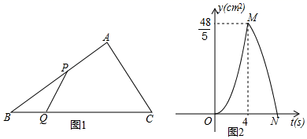

# Mathematics - 题目 2289

**ID**: 74043809c9be41608a63c276b7a4eda2
**年级**: Grade 9
**难度**: Medium-Hard
**题型**: Multiple-choice

## 题目
如图1，在Rt△ABC中，∠A＝90°，BC＝10cm，点P，点Q同时从点B出发，点P以2cm/s的速度沿B→A→C运动，终点为C，点Q出发t秒时，△BPQ的面积为ycm^{2}，已知y与t的函数关系的图象如图2（曲线OM和MN均为抛物线的一部分），给出以下结论：①AC＝6cm；​​​​​​​‌②曲线MN的解析式为y＝﹣ $\frac {4}{5}$t^{2}＋ $\frac {28}{5}$t（4⩽t⩽7）；③线段PQ的长度的最大值为 $\frac {6}{5}\sqrt {10}$ cm；④若△PQC与△ABC相似，则t＝ $\frac {40}{7}$ 秒，其中正确的说法是（      ）

## 解答

1. 解：①由图2可知： $t=4$ 时， $y=\frac {48}{5}$ ，
2. $\therefore AB=2\times 4=8cm$ ，
3. $\because \angle A=90{}^\circ $ ， $BC=10cm$ ，
4. $\therefore AC=6cm$ ，故①正确；
5. ②当 $P$ 在 $AC$ 上时，如图3，过 $P$ 作 $PD\bot BC$ 于 $D$ ，
6. 
7. 此时： $\frac {6+8}{2}=7$ ，
8. ∴ $4\leqslant t\leqslant 7$ ，
9. 由题意得： $AB+AP=2t$ ， $BQ=t$ ，
10. $\therefore PC=14-2t$ ，
11. ${\sin}\angle C=\frac {PD}{PC}=\frac {AB}{BC}$ ，
12. $\therefore $  $\frac {PD}{14-2t}=\frac {8}{10}=\frac {4}{5}$ ，
13. $\therefore PD=\frac {4(14-2t)}{5}$ ，
14. $\therefore y=S{{}_{ΔBPQ}}=\frac {1}{2}BQ\centerdot PD=\frac {1}{2}t\centerdot \frac {4(14-2t)}{5}=-\frac {4}{5}t{^{2}}+\frac {28}{5}t$ ，故②正确；
15. ③当 $P$ 与 $A$ 重合时， $PQ$ 最大，如图4，此时 $t=4$ ，
16. $\therefore BQ=4$ ，
17. 过 $Q$ 作 $GH\bot AB$ 于 $H$ ，
18. 
19. ${\sin}\angle B=\frac {QH}{BQ}=\frac {AC}{BC}$ ，
20. $\therefore $  $\frac {QH}{4}=\frac {6}{10}$ ，
21. $\therefore QH=\frac {12}{5}$ ，
22. 同理： $BH=\frac {16}{5}$ ，
23. $\therefore AH=8-\frac {16}{5}=\frac {24}{5}$ ，
24. $\therefore PQ=\sqrt {AH{^{2}}+QH{^{2}}}=\sqrt {(\frac {24}{5}){^{2}}+(\frac {12}{5}){^{2}}}=\frac {12}{5}\sqrt {5}$ ；
25. $\therefore $ 线段 $PQ$ 的长度的最大值为 $\frac {12}{5}\sqrt {5}$ ，故③不正确；
26. ④若 $\Delta PQC$ 与 $ΔABC$ 相似，点 $P$ 只有在线段 $AC$ 上，
27. 分两种情况： $PC=14-2t$ ， $QC=10-t$ ，
28. $i)$ 当 $ΔCPQ∽ΔCBA$ ，如图5，则 $\frac {PC}{CB}=\frac {CQ}{AC}$ ，
29. 
30. $\therefore $  $\frac {14-2t}{10}=\frac {10-t}{6}$ ，
31. 解得 $t=-8$ 不合题意．
32. $ii)$ 当 $ΔPQC∽ΔABC$ 时，如图6，
33. 
34. $\therefore $  $\frac {PC}{AC}=\frac {QC}{BC}$ ，
35. $\therefore $  $\frac {14-2t}{6}=\frac {10-t}{10}$ ，
36. $t=\frac {40}{7}$ ；
37. $\therefore $ 若 $\Delta PQC$ 与 $ΔABC$ 相似，则 $t=\frac {40}{7}$ 秒，故④正确；
38. 其中正确的有：①②④，
39. 故选：A．

## 知识点

**中文**:
  - 二次函数的图象和性质
  - 从函数的图象获取信息
  - 勾股定理
  - 相似三角形的判定与性质综合

**English**:
  - Graphs and Properties of Quadratic Functions
  - Extracting Information from Graphs
  - Pythagorean Theorem
  - Determination and Properties

---
