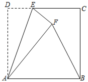

# Mathematics - 题目 2780

**ID**: 7b104161a2ba4935b20ae4d9010bb94a
**年级**: Grade 9
**难度**: Medium-Hard
**题型**: Multiple-choice

## 题目
如图，在边长为4的正方形ABCD中，点E是CD边上的一点，点F是点D关于直线AE对称的点，连接AF、BF，若tan∠ABF＝2，则DE的长是（      ）​​​​​​​‌

## 解答

1. 解：过点F作FN⊥AB于点N，并延长NF交CD于点M，
2. 
3. ∵AB∥CD，
4. ∴MN⊥CD，
5. ∴∠FME＝90°，
6. ∵tan∠ABF＝2，
7. ∴ $\frac {FN}{BN}$ ＝2，
8. 设BN＝x，则FN＝2x，
9. ∴AN＝4﹣x，
10. ∵点F是点D关于直线AE对称的点，
11. ∴DE＝EF，DA＝AF＝4，
12. ∵AE＝AE，
13. ∴△ADE≌△AFE（SSS），
14. ∴∠D＝∠AFE＝90°，
15. ∵AN^{2}＋NF^{2}＝AF^{2}，
16. ∴（4﹣x）^{2}＋（2x）^{2}＝4^{2}，
17. ∴x_{1}＝0（舍），x_{2}＝ $\frac {8}{5}$ ，
18. ∴AN＝4﹣x＝4﹣ $\frac {8}{5}$ ＝ $\frac {12}{5}$ ，MF＝4﹣2x＝4﹣ $\frac {16}{5}$ ＝ $\frac {4}{5}$ ，
19. ∵∠EFM＋∠AFN＝∠AFN＋∠FAN＝90°，
20. ∴∠EFM＝∠FAN，
21. ∴cos∠EFM＝cos∠FAN，
22. ∴ $\frac {FM}{EF}$ ＝ $\frac {AN}{AF}$ ，即 $\frac {\frac {4}{5}}{{\rm{E}}{\rm{F}}}{\rm{=}}\frac {\frac {12}{5}}{4}$ ，
23. ∴EF＝ $\frac {4}{3}$ ，
24. ∴DE＝EF＝ $\frac {4}{3}$ ．
25. 故选：C．

## 知识点

**中文**:
  - 余弦
  - 勾股定理
  - 正方形的性质

**English**:
  - Cosine
  - Pythagorean Theorem
  - Properties of Squares

---
