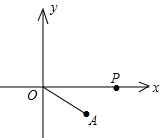

# Mathematics - 题目 2816

**ID**: 889f50e57bb1476ab3489af7065847c1
**年级**: Grade 9
**难度**: Medium-Hard
**题型**: Multiple-choice

## 题目
如图，坐标平面内一点A(2，－1)，O为原点，P是x轴上的一个动点，如果以点P、O、A为顶点的三角形是等腰三角形，那么符合条件的动点P的个数为（      ）​​​​​​​‌

## 解答

1. 以O点为圆心，OA为半径作圆与x轴有两交点，这两点显然符合题意．以A点为圆心，OA为半径作圆与x轴交于两点（O点除外）．以OA中点为圆心OA长一半为半径作圆与x轴有一交点．共4个点符合，

## 知识点

**中文**:
  - 等腰三角形的判定与性质

**English**:
  - Determination and Properties

---
