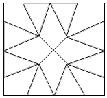

# Mathematics - 题目 502

**ID**: 9596dcab0d3a433983143330cd6a40cd
**年级**: Grade 9
**难度**: Medium-Hard
**题型**: Multiple-choice

## 题目
如图是用8块 $A$ 型瓷砖（白色四边形）和8块 $B$ 型瓷砖（黑色三角形）不重叠、无空隙拼接而成的一个正方形图案，图案中 $A$ 型瓷砖的总面积与 $B$ 型瓷砖的总面积之比为（      ）​​​​​​​‌

## 解答

1. 如图，作 $DC\bot EF$ 于 $C$ ， $DK\bot FH$ 于 $K$ ，连接 $DF$ ．
2. 由题意：四边形 $DCFK$ 是正方形， $\angle CDM=\angle MDF=\angle FDN=\angle NDK$ ，
3. ∴ $\angle CDK=\angle DKF=90{}^\circ $ ， $DK=FK$ ， $DF=\sqrt {2}DK$ ，
4. ∵DN平分∠FDK，
5. ∴△DFN与△DNK的高相等，底分别为DF与DK.
6. ∴ $\frac {S{{}_{ΔDFN}}}{S{{}_{ΔDNK}}}=\frac {FN}{NK}=\frac {DF}{DK}=\sqrt {2}$
7. ∴ $\frac {S{{}_{A型}}}{S{{}_{B型}}}=\frac {2S{{}_{ΔDFN}}}{2S{{}_{ΔDNK}}}=\sqrt {2}$ ，
8. ∴图案中 $A$ 型瓷砖的总面积与 $B$ 型瓷砖的总面积之比为 $\sqrt {2}:1$ ，
9. 故选：A．
10. 

## 知识点

**中文**:
  - 正方形的判定与性质综合

**English**:
  - Determination and Properties of Squares

---
