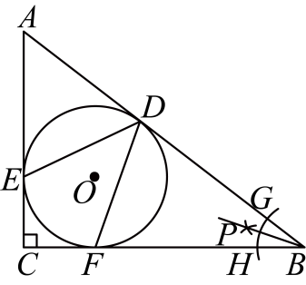

# Mathematics - 题目 423

**ID**: 977a078800934821b431977b6c07e391
**年级**: Grade 9
**难度**: Medium-Hard
**题型**: Multiple-choice

## 题目
如图，在 ${\rm{R}}{\rm{t}}\mathrm{△}ABC$ 中， $\angle C=90{}\degree $ ， $AC=6$ ， $BC=8$ ． ${\rm{R}}{\rm{t}}\mathrm{△}ABC$ 的内切圆 $\odot O$ 与 $AB,AC,BC$ 分别相切于点 $D,\,E,\,F$ ，连接 $DE,DF$ ．以点 $B$ 为圆心，以适当长为半径作弧分别交 $AB,BC$ 于 $G,H$ 两点；​​​​​​​‌分别以点 $G,H$ 为圆心，以大于 $\frac {1}{2}GH$ 的长为半径作弧，两条弧交于点 $P$ ；作射线 $BP$ ．下列说法错误的是（      ）

## 解答

1. 解：由作图可知， $BP$ 平分 $∠ABC$ ，故选项A正确；
2. ∵ $\odot O$ 是 ${\rm{R}}{\rm{t}}\mathrm{△}ABC$ 的内切圆，
3. ∴点 $O$ 为三角形三条角平分线的交点，
4. ∴点 $O$ 在射线 $BP$ 上，故选项B正确；
5. 连接 $OE,OF$ ，则 $OE\bot AC,OF\bot CF,OE=OF,AE=AD,CF=CE,BF=BD$ ， $\angle C=90{}\degree $ ，
6. 
7. ∴四边形 $OECF$ 为正方形，
8. ∴ $\angle EOF=90{}\degree $ ， $CE=CF=OE=OF$ ，
9. ∴ $\angle EDF=\frac {1}{2}\angle EOF=45{}\degree $ ，故选项C正确；
10. ∵ $\angle C=90{}\degree $ ， $AC=6$ ， $BC=8$ ，
11. ∴ $AB=10$ ，
12. 设 $\odot O$ 的半径为 $r$ ，则 $CE=CF=OE=OF=r$ ，
13. ∴ $BD=BF=8-r,AD=AE=6-r$ ，
14. ∴ $AB=BD+AD=8-r+6-r=10$ ，
15. ∴ $r=2$ ，故选项D错误.
16. 故此题答案为D．

## 知识点

**中文**:
  - 三角形内切圆
  - 圆周角定理及推论
  - 切线长定理

**English**:
  - Incircle of Triangle
  - Inscribed Angle Theorem
  - Tangent Length Theorem

---
