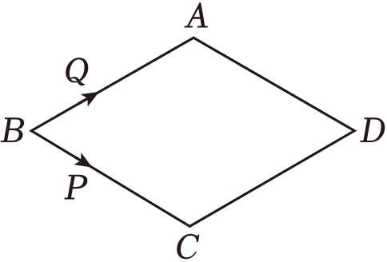

# Mathematics - 题目 3766

**ID**: 9a50d01f97b44890b4afaa855fed6932
**年级**: Grade 9
**难度**: Medium-Hard
**题型**: Multiple-choice

## 题目
如图，菱形 $ABCD$ 的边长为 ${\rm 3cm，}∠B{\rm{=}}{{6}}{{0}}{}\degree $ ，动点P从点B出发以 $3{\rm{c}}{\rm{m}}{\rm{/}}{\rm{s}}$ 的速度沿着边 $BC-CD-DA$ 运动，到达点A后停止运动；​​​​​​​‌同时动点Q从点B出发，以 $1{\rm{c}}{\rm{m}}{\rm{/}}{\rm{s}}$ 的速度沿着边 $BA$ 向A点运动，到达点A后停止运动．设点P的运动时间为x（s），△BPQ的面积为y（cm^{2}），则y关于x的函数图象为（      ）

## 解答

1. 解：∵点P的速度是 $3{\rm{c}}{\rm{m}}{\rm{/}}{\rm{s}}$ ，点Q的速度为 $1{\rm{c}}{\rm{m}}{\rm{/}}{\rm{s}}$ ，运动时间为x（s），
2. ∴点P运动的路程为 $3x{\rm{c}}{\rm{m}}{\rm{/}}{\rm{s}}$ ，点Q运动的路程为 $x{\rm{c}}{\rm{m}}{\rm{/}}{\rm{s}}$ ．
3. ①当 $0\leqslant x\leqslant 1$ 时，点P在线段 $BC$ 上，点Q在线段 $AB$ 上．
4. 
5. 过点Q作 $QE\bot BC$ 于点E，
6. ∴ $\angle BEQ=90{}\degree $ ．
7. ∵ $∠B{\rm{=}}{{6}}{{0}}{}\degree $ ，
8. ∴ $\angle BQE=30{}\degree $ ．
9. ∴ $BE=\frac {1}{2}x{\rm{c}}{\rm{m}}$ ．
10. ∴ $QE=\frac {\sqrt {3}}{2}x{\rm{c}}{\rm{m}}$ ．
11. ∴ $S{{}_{\vartriangle BPQ}}=\frac {1}{2}BP\cdot QE=\frac {1}{2}\times 3x\cdot \frac {\sqrt {3}}{2}x=\frac {3\sqrt {3}}{4}x{^{2}}\left ({{\rm{c}}{\rm{m}}{^{2}}}\right )$ ．
12. ∴ $y=\frac {3\sqrt {3}}{4}x{^{2}}\left ({0\leqslant x\leqslant 1}\right )$ ．
13. ∴此段函数图象为开口向上的二次函数图象，排除B；
14. ②当 $1<x\leqslant 2$ 时，点P在线段 $CD$ 上，点Q在线段 $AB$ 上．
15. 过点C作 $CF\bot AB$ 于点F，则 $CF$ 为 $\vartriangle BPQ$ 中 $BQ$ 边上的高．
16. 
17. ∴ $\angle BFC=90{}\degree $ ．
18. ∵ $\angle ABC=60{}\degree $ ，
19. ∴ $\angle BCF=30{}\degree $ ．
20. ∵ $BC=3{\rm{c}}{\rm{m}}$ ，
21. ∴ $BF=\frac {3}{2}{\rm{c}}{\rm{m}}$ ．
22. ∴ $CF=\frac {3\sqrt {3}}{2}{\rm{c}}{\rm{m}}$ ．
23. ∴ $S{{}_{\vartriangle BPQ}}=\frac {1}{2}BQ\cdot CF=\frac {1}{2}x\cdot \frac {3\sqrt {3}}{2}=\frac {3\sqrt {3}}{4}x\left ({{\rm{c}}{\rm{m}}{^{2}}}\right )$ ．
24. ∴ $y=\frac {3\sqrt {3}}{4}x\left ({1<x\leqslant 2}\right )$ ．
25. ∴此段函数图象为y随x的增大而增大的正比例函数图象，故排除A；
26. ③当 $2<x\leqslant 3$ 时，点P在线段 $AD$ 上，点Q在线段 $AB$ 上．
27. 过点P作 $PM\bot AB$ 于点M．
28. 
29. ∴ $\angle M=90{}\degree $ ．
30. ∵四边形 $ABCD$ 是菱形，
31. ∴ $AD\mathrm{/\mskip-4mu/}BC$ ．
32. ∵ $\angle ABC=60{}\degree $ ，
33. ∴ $\angle MAP=60{}\degree $ ．
34. ∴ $\angle APM=30{}\degree $ ．
35. 由题意得： $AP=\left ({9-3x}\right ){\rm{c}}{\rm{m}}$ ．
36. ∴ $AM=\frac {9-3x}{2}{\rm{c}}{\rm{m}}$ ．
37. ∴ $PM=\frac {9\sqrt {3}-3\sqrt {3}x}{2}{\rm{c}}{\rm{m}}$ ．
38. ∴ $S{{}_{\vartriangle BPQ}}=\frac {1}{2}BQ\cdot PM=\frac {1}{2}x\cdot \frac {9\sqrt {3}-3\sqrt {3}x}{2}=\frac {-3\sqrt {3}x{^{2}}+9\sqrt {3}x}{4}\left ({{\rm{c}}{\rm{m}}{^{2}}}\right )$ ．
39. ∴ $y=\frac {-3\sqrt {3}x{^{2}}+9\sqrt {3}x}{4}$ ．
40. ∴此段函数图象为开口向下的二次函数图象．
41. 故选D．

## 知识点

**中文**:
  - 反比例函数的应用
  - 图形问题
  - 菱形的性质

**English**:
  - Applications of Inverse Proportionality
  - Geometric Problems
  - Properties of Rhombuses

---
