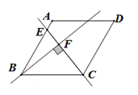

# Mathematics - 题目 2925

**ID**: a04f2246b69748afa1b34e2e61701261
**年级**: Grade 9
**难度**: Medium-Hard
**题型**: Multiple-choice

## 题目
如图，在菱形 $ABCD$ 中， $\angle ABC=60{}^\circ $ ，AB=6，点 $E$ 是 $AB$ 边上的动点，过点 $B$ 作直线 $CE$ 的垂线，垂足为 $F$ ，当点 $E$ 从点 $A$ 运动到点 $B$ 时，点 $F$ 的运动路径长为（      ）​​​​​​​‌

## 解答

1. 解：如图，取BC的中点O，连接OF．
2. 
3. ∵∠CFB=90°，
4. ∴点F的运动轨迹是以BC为直径的，圆弧BM，
5. 当点E与A重合时，点F与AC中点M重合，
6. ∵四边形ABCD是菱形，∠ABC=60°，
7. ∴△ABC是等边三角形
8. ∴∠BCM=60°，
9. ∵OM=OC=OB= $\frac {6}{2}$  =3，
10. ∴△OMC是等边三角形，
11. ∴∠MOC=60°，
12. ∴∠BOM=120°，
13. 弧BM= $\frac {120\centerdot π\centerdot 3}{180}=2π$  ，
14. 故选：C；

## 知识点

**中文**:
  - 等边三角形的性质
  - 菱形的性质

**English**:
  - Properties of Equilateral Triangles
  - Properties of Rhombuses

---
