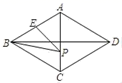

# Mathematics - 题目 1073

**ID**: a0934121dfb1457abb252a5ba8fc8651
**年级**: Grade 9
**难度**: Medium-Hard
**题型**: Multiple-choice

## 题目
如图，在菱形ABCD中，AC与BD相交于点O，AB＝4，BD＝4 $\sqrt {3}$ ，E为AB的中点，点P为线段AC上的动点，则EP+BP的最小值为（      ）​​​​​​​‌

## 解答

1. 如图，设AC，BD相交于O，
2. 
3. ∵四边形ABCD是菱形，
4. ∴AC⊥BD，AO＝ $\frac {1}{2}$ AC，BO＝ $\frac {1}{2}$ BD＝2 $\sqrt {3}$ ，
5. ∵AB＝4，
6. ∴AO＝2，
7. 连结DE交AC于点P，连结BP，作EM⊥BD于点M，
8. ∵四边形ABCD是菱形，
9. ∴AC⊥BD，且DO＝BO，即AO是BD的垂直平分线，
10. ∴PD＝PB，
11. ∴PE+PB＝PE+PD＝DE且值最小，
12. ∵E是AB的中点，EM⊥BD，
13. ∴EM＝ $\frac {1}{2}$ AO＝1，BM＝ $\frac {1}{2}$ BO＝ $\sqrt {2}$ ，
14. ∴DM＝DO+OM＝ $\frac {3}{2}$ BO＝3 $\sqrt {3}$ ，
15. ∴DE＝ $\sqrt {{\rm{E}}M{^{2}}+{\rm{D}}{\rm{M}}{^{2}}}=\sqrt {1{^{2}}+(3\sqrt {3}){^{2}}}=2\sqrt {7}$ ，
16. 故选C．

## 知识点

**中文**:
  - 几何变换——轴对称综合题
  - 菱形的判定与性质综合

**English**:
  - Axial Symmetry Comprehensive Problems
  - Determination and Properties of Rhombuses

---
