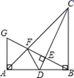

# Mathematics - 题目 1273

**ID**: a51eee5c087e4e80ad2e19bbbc28a7ed
**年级**: Grade 9
**难度**: Medium-Hard
**题型**: Multiple-choice

## 题目
如图，在 $Rt\Delta ABC$ 中， $\angle ABC=90{}^\circ ,BA=BC$ ．点 $D$ 是 $AB$ 的中点，连结 $CD$ ，过点 $B$ 作 $BG\bot CD$ ，分别交 $CD、CA$ 于点 $E、F$ ，与过点 $A$ 且垂直于 $AB$ 的直线相交于点 $G$ ，连结 $DF$ ．给出以下四个结论：① $\frac {AG}{AB}=\frac {FG}{FB}$ ；​​​​​​​‌②点 $F$ 是 $GE$ 的中点；③ $AF=\frac {\sqrt {2}}{3}AB$ ；④ $S{{}_{ΔABC}}=6S{{}_{ΔBDF}}$ ，其中正确的个数是（      ）

## 解答

1. 解：由题意知，△ABC是等腰直角三角形，
2. 设AB＝BC＝2，则AC＝2 $\sqrt {2}$ ，
3. ∵点D是AB的中点，
4. ∴AD＝BD＝1，
5. 在Rt△DBC中，DC＝ $\sqrt {5}$ ，（勾股定理）
6. ∵BG⊥CD，
7. ∴∠DEB＝∠ABC＝90°，
8. 又∵∠CDB＝∠BDE，
9. ∴△CDB∽△BDE，
10. ∴∠DBE＝∠DCB， $\frac {BD}{DE}=\frac {CD}{BD}=\frac {CB}{BE}$  ,即 $\frac {1}{DE}=\frac {\sqrt {5}}{1}=\frac {2}{BE}$
11. ∴DE＝ $\frac {\sqrt {5}}{5}$  ，BE＝ $\frac {2\sqrt {5}}{5}$ ,
12. 在△GAB和△DBC中， $\begin{cases}\angle DBE=\angle DCB\\AD=BC\\\angle GAB=\angle DBC\end{cases}$
13. ∴△GAB≌△DBC(ASA)
14. ∴AG＝DB＝1，BG＝CD＝ $\sqrt {5}$ ，
15. ∵∠GAB+∠ABC＝180°，
16. ∴AG∥BC，
17. ∴△AGF∽△CBF，
18. ∴ $\frac {AG}{CB}=\frac {AF}{CF}=\frac {GF}{BF}=\frac {1}{2}$ ，且有AB＝BC，故①正确，
19. ∵GB＝ $\sqrt {5}$ ，AC＝2 $\sqrt {2}$ ，
20. ∴AF＝ $\frac {2\sqrt {2}}{3}$ ＝ $\frac {\sqrt {2}}{3}AB$ ，故③正确，
21. GF＝ $\frac {\sqrt {5}}{3}$ ，FE＝BG﹣GF﹣BE＝ $\frac {4\sqrt {5}}{15}$ ，故②错误，
22. S_{△}_{ABC}＝ $\frac {1}{2}$AB•AC＝2，S_{△}_{BDF}＝ $\frac {1}{2}$BF•DE＝ $\frac {1}{2}$ × $\frac {2\sqrt {5}}{3}$ × $\frac {\sqrt {5}}{5}$ ＝ $\frac {1}{3}$ ，故④正确．
23. 故选B．

## 知识点

**中文**:
  - 相似三角形的综合问题

**English**:
  - Comprehensive Similar Triangle Problems

---
