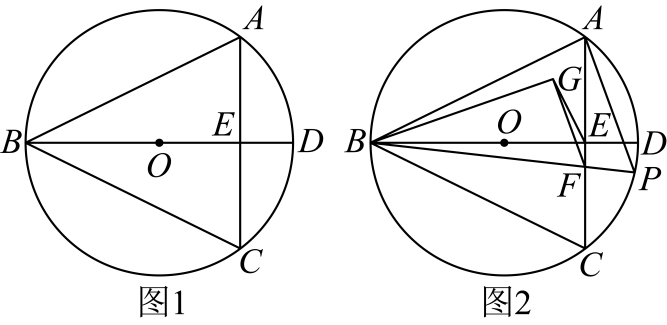

# Mathematics - 题目 1823

**ID**: a960535dba3e4fe8ab07d12a4eb526ff
**年级**: Grade 9
**难度**: Medium-Hard
**题型**: Multiple-choice

## 题目
如图 ${\rm 1，}\odot O$ 外接于 $\vartriangle ABC$ ，直径 $BD$ 交 $AC$ 于点E，已知 $AB=BC=2\sqrt {5}$ ， $AC=4$ ．（1）求 $DE$ 的长；​​​​​​​‌（2）如图2，F是线段 $CE$ 上一点（不与C，E重合）， $BF$ 的延长线交 $\odot O$ 于点 ${\rm \mathit{P}，}FG{\rm{/\mskip-4mu/}}AP$ ， $FG\bot BG$ ．①求证： $△BEG{\rm{∽}}△BCF$ ；②若 $CF=OE$ ，求证：O，G，A三点共线．

## 解答

1. （1）解：如图，连接 $AD$ ， $CD$ ．
2. 
3. ∵ $BD$ 是 $\odot O$ 的直径，
4. ∴ $\angle BAD=\angle BCD=90{}\degree $ ．
5. ∵ $AB=BC$ ， $BD=BD$ ，
6. ∴ ${\rm{R}}{\rm{t}}\vartriangle BAD≌{\rm{R}}{\rm{t}}\vartriangle BCD\left ({{\rm{H}}{\rm{L}}}\right )$ ，
7. ∴ $AD=CD$ ，
8. ∴ $BD$ 垂直平分线段 $AC$ ，
9. ∴ $AE=CE=\frac {1}{2}AC=2$ ．
10. ∵ $AB=BC=2\sqrt {5}$ ，
11. ∴ $BE=\sqrt {AB{^{2}}-AE{^{2}}}=\sqrt {{\left({2\sqrt {5}}\right)^{2}}-2{^{2}}}=4$ ．
12. 在 ${\rm{R}}{\rm{t}}\vartriangle BAD$ 和 ${\rm{R}}{\rm{t}}\vartriangle BEA$ 中， $\angle BAD=\angle BEA=90{}\degree $ ，
13. ∴ ${\cos}\angle ABE=\frac {BE}{AB}=\frac {AB}{BD}$ ．
14. ∴ $BD=\frac {AB{^{2}}}{BE}=5$ ．
15. ∴ $DE=BD-BE=1$ ．
16. （2）解：①∵ $FG{\rm{/\mskip-4mu/}}AP$ ，
17. ∴ $\angle P=\angle BFG$ ．
18. 又∵ $\angle P=\angle C$ ，
19. ∴ $\angle BFG=\angle C$ ．
20. ∵ $FG\bot BG$ ， $BE\bot AC$ ，
21. ∴ $\angle BGF=\angle BEC=90{}\degree $ ．
22. 设M为线段 $BF$ 的中点，连接 $ME$ ， $MG$ ．
23. 
24. 则 $ME=MG=MB=MF=\frac {1}{2}BF$ ，
25. ∴点B，G，E，F都在 $\odot M$ 上，
26. ∴ $\angle BFG=\angle BEG$ ．
27. ∴ $\angle BEG=\angle C$ ．
28. ∵ $\angle GBF+\angle BFG=\angle EBC+\angle C=90{}\degree $ ，
29. ∴ $\angle GBF=\angle EBC$ ．
30. ∴ $\angle GBF-\angle EBF=\angle EBC-\angle EBF$ ，
31. ∴ $\angle GBE=\angle FBC$ ．
32. ∴ $△BEG{\rm{∽}}△BCF$ ．
33. ②如图，连接 $OG$ ， $OA$ ．
34. 
35. ∵ $\angle BAD=90{}\degree $ ，
36. ∴ $AD=\sqrt {BD{^{2}}-AB{^{2}}}=\sqrt {5}$ ．
37. ∵ $OD=\frac {1}{2}BD=\frac {5}{2}$ ，
38. ∴ $OE=OD-DE=\frac {3}{2}$ ．
39. 则 $CF=OE=\frac {3}{2}$ ．
40. 由①知， $△BEG{\rm{∽}}△BCF$ ，
41. ∴ $\frac {BE}{BC}=\frac {GE}{CF}$ ．
42. ∴ $GE=\frac {BE\cdot CF}{BC}=\frac {3\sqrt {5}}{5}$ ．
43. ∴ $\frac {GE}{AD}=\frac {OE}{OD}=\frac {3}{5}$ ．
44. ∵ $\angle D=\angle C$ ， $\angle GEB=\angle C$ ，
45. ∴ $\angle GEB=\angle D$ ．
46. ∴ $△GEO{\rm{∽}}△ADO$ ．
47. ∴ $\angle GOE=\angle AOD$ ．
48. ∴O，G，A三点共线．

## 知识点

**中文**:
  - 半圆（或直径）所对的圆周角是直角
  - 相似三角形的判定与性质综合
  - 解直角三角形

**English**:
  - Angle in a Semicircle is Right
  - Determination and Properties
  - Solving Right Triangles

---
