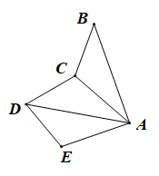

# Mathematics - 题目 2536

**ID**: b3fc4ead3948499eb3247bf47d3e029b
**年级**: Grade 9
**难度**: Medium-Hard
**题型**: Multiple-choice

## 题目
如图，将 $\vartriangle ABC$ 绕点 $A$ 逆时针旋转60°得到 $\vartriangle ADE$ ，连接 $CD$ ．若 $\angle CDE=75{}^\circ $ ， $AD=6$ ，则四边形 $EACD$ 面积的最小值是（      ）​​​​​​​‌

## 解答

1. 由旋转得： $\mathrm{△}BAC≌\mathrm{△}DEA$ ，
2. ∴ $S{{}_{\mathrm{△}ABC}}=S{{}_{\mathrm{△}DEA}}$ ，
3. 设四边形 $EACD$ 面积为S，
4. ∴ $S=S{{}_{\mathrm{△}DCA}}+S{{}_{\mathrm{△}ADE}}=S{{}_{\mathrm{△}DCA}}+S{{}_{\mathrm{△}BCA}}=S{{}_{\mathrm{△}ABD}}-S{{}_{\mathrm{△}BCD}}$ ．
5. 由旋转可知，AB＝AD，而∠DAB＝60°，
6. ∴△ABD是等边三角形，
7. ∴ $BD=AD=AB{\rm{=}}6$ ，∠ADB＝∠ABD＝∠DAB＝60°，
8. ∴ $S{{}_{\vartriangle ABD}}$  $=\frac {1}{2}{\rm{A}}{\rm{B}}\cdot {\rm{B}}{\rm{D}}\cdot {\sin}60{^{\circ }}{\rm{=}}\frac {\sqrt {3}}{4}\times 6{^{2}}=9\sqrt {3}$ ，
9. ∴ $S{{}_{△BCD}}$ 最大时， $S$ 最小，
10. 作 $\vartriangle DCB$ 的外接圆 $O$ ，
11. 
12. 易知 $\angle DCB=75{}^\circ +60{}^\circ =135{}^\circ $ ．
13. ∴ $\angle DOB=90{}^\circ $ ， $OB=OD=3\sqrt {2}$ ．
14. 当 $C$ 为 $\overset ⌢{{BC}}$ 中点时， $\vartriangle DOB$ 面积最大，
15. 过 $D$ 作 $DF\bot BF$ 于 $F$ ，则 $\angle DCF=45{}^\circ $ ．
16. 设 $DF=CF=a$ ， $DC=BC=\sqrt {2}a$ ．
17. ∴ $a{^{2}}+{\left({a+\sqrt {2}a}\right)^{2}}=36$ ， $a{^{2}}=18-9\sqrt {2}$ ．
18. ∴ $S{{}_{\mathrm{△}CDB}}=\frac {1}{2}\times \sqrt {2}a\times a=\frac {\sqrt {2}}{2}a{^{2}}=9\sqrt {2}-9$ ．
19. ∴ $S\geqslant 9\sqrt {3}-\left ({9\sqrt {2}-9}\right )=9\sqrt {3}-9\sqrt {2}+9$ ．
20. 故选D．

## 知识点

**中文**:
  - 三角函数综合
  - 圆的综合问题
  - 几何变换——旋转综合题

**English**:
  - Comprehensive Trig Problems
  - Comprehensive Circle Problems
  - Rotation Comprehensive Problems

---
