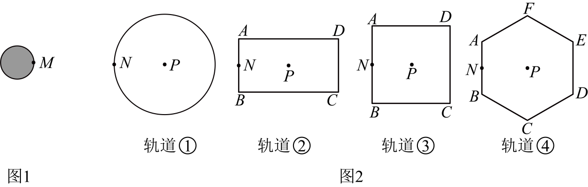

# Mathematics - 题目 2064

**ID**: b5ee688062524c0db34915fa2959b878
**年级**: Grade 9
**难度**: Medium-Hard
**题型**: Multiple-choice

## 题目
图1是半径为 $1{\rm{c}}{\rm{m}}$ 的圆形硬币，点 $M$ 是硬币外沿上的一定点．图2为四个轨道（厚度不计），分别记为轨道①、②、③和④，它们的形状分别为圆、长宽比为 $2:1$ 的矩形、正方形和正六边形，周长均为 $6π{\rm{c}}{\rm{m}}$ ，对称中心均记为点P．点 $N$ 为轨道上一定点（除轨道①外， $N$ 均为 $AB$ 的中点）．将硬币放置在轨道外侧，使硬币与轨道在同一个平面内，且点 $M$ 与 $N$ 重合．若硬币沿轨道顺时针无滑动地滚动，当点 $M$ 第一次回到轨道上时，记轨道上该处位置为 $N^{′}$ ，则四个轨道中， $\angle NPN^{′}$ 最大的是（      ）​​​​​​​‌

## 解答

1. 解：∵圆形硬币的半径为 $1{\rm{c}}{\rm{m}}$ ，
2. ∴圆形硬币的周长为 $2π{\rm{c}}{\rm{m}}$ ，
3. ∴硬币沿轨道顺时针无滑动地滚动，当点 $M$ 第一次回到轨道上时，点M的运动路径长为 $2π{\rm{c}}{\rm{m}}$ ；
4. 当沿着轨道①滚动时，则 $\overset{\frown}{{NN^{′}}}$ 的长为 $2π{\rm{c}}{\rm{m}}$ ，
5. ∴ $∠NPN^{′}=360{}\degree \times \frac {2π}{6π}=120{}\degree $ ；
6. 
7. 当沿着轨道②滑动时，
8. ∵四边形 $ABCD$ 是长宽比为 $2:1$ 的矩形，
9. ∴ $AD=BC=2AB=2CD$ ，
10. ∵四边形 $ABCD$ 的周长为 $6π{\rm{c}}{\rm{m}}$ ，
11. ∴ $AB=CD=π{\rm{c}}{\rm{m}}，AD=BC=2π{\rm{c}}{\rm{m}}$ ，
12. ∵点N为 $AB$ 的中点，
13. ∴ $AN=\frac {1}{2}AB=\frac {π}{2}{\rm{c}}{\rm{m}}$ ，
14. ∴ $AN^{′}=2π-\frac {π}{2}=\frac {3}{2}π{\rm{c}}{\rm{m}}$ ；
15. 如图所示，过点P作 $PH\bot AD$ 于H，连接 $PA，PB，PN，PN^{′}，PD$ ，
16. ∵点P为矩形 $ABCD$ 的对称中心，
17. ∴ $PA=PB=PD$ ，
18. ∴ $PN\bot AB$ ， $AH=DH=\frac {1}{2}AD=π{\rm{c}}{\rm{m}}$ ，
19. 又∵ $PH\bot AD$ ， $\angle NAH=90{}\degree $ ，
20. ∴四边形 $ANPH$ 是矩形，
21. ∴ $PH=AN=\frac {π}{2}{\rm{c}}{\rm{m}}，∠NPH=90{}\degree $ ，
22. ∵ $N^{′}H=AN^{′}-AH=\frac {π}{2}{\rm{c}}{\rm{m}}$ ，
23. ∴ $HP=HN^{′}$ ，
24. ∴ $△HPN^{′}$ 是等腰直角三角形，
25. ∴ $∠HPN^{′}=45{}\degree $ ，
26. ∴ $∠NPN^{′}=∠NPH+∠HPN^{′}=135{}\degree $ ；
27. 
28. 当沿轨道③滑动时，
29. ∵正方形 $ABCD$ 的周长为 $6π{\rm{c}}{\rm{m}}$ ，
30. ∴ $AB=AD=1.5π{\rm{c}}{\rm{m}}$ ，
31. ∵点N为 $AB$ 的中点，
32. ∴ $AN=\frac {1}{2}AB=0.75π{\rm{c}}{\rm{m}}$ ，
33. ∴ $AN^{′}=2π-0.75=1.25π{\rm{c}}{\rm{m}}$ ，
34. 如图所示，过点P作 $PH\bot AD$ 于H，连接 $PA，PB，PN，PN^{′}，PD$ ，
35. 同理可得 $AH=DH=\frac {1}{2}AD=0.75π{\rm{c}}{\rm{m}}，PH=AN=0.75π{\rm{c}}{\rm{m}}$ ， $\angle NPH=90{}\degree $ ，
36. ∴ $HN^{′}=1.25π{\rm{c}}{\rm{m}}-0.75π{\rm{c}}{\rm{m}}=0.5π{\rm{c}}{\rm{m}}$ ，
37. ∴ $HN^{′}<PH$ ，
38. ∴ $∠HPN^{′}<45{}\degree $ ，
39. ∴ $∠NPN^{′}=∠NPH+∠HPN^{′}<90{}\degree +45{}\degree =135{}\degree $ ；
40. 
41. 当沿着轨道④滑动时，
42. ∵正六边形 $ABCDEF$ 的周长为 $6π{\rm{c}}{\rm{m}}$ ，
43. ∴ $AB=AF=EF=π{\rm{c}}{\rm{m}}$ ，
44. ∵点N为 $AB$ 的中点，
45. ∴ $AN=\frac {1}{2}AB=0.5π{\rm{c}}{\rm{m}}$ ，
46. ∴点 $N^{′}$ 是 $EF$ 的中点，
47. 如图所示，连接 $PA，PB，PF$ ，则 $∠APB=∠APF=\frac {360{}\degree }{6}=60{}\degree $ ，
48. 又∵ $PA=PB=PF$ ，
49. ∴ $△APB，△APF$ 都是等边三角形，
50. ∴ $∠APB=∠APF=60{}\degree $ ，
51. ∴ $\angle APN=30{}\degree $ ，
52. 同理可得 $∠FPN^{′}=30{}\degree $ ，
53. ∴ $∠NPN^{′}=30{}\degree +60{}\degree +30{}\degree =120{}\degree $ ；
54. 
55. 综上所述，当沿着轨道②滚动时， $\angle NPN^{′}$ 最大，
56. 故选B．

## 知识点

**中文**:
  - 正多边形和圆
  - 等边三角形的判定与性质
  - 矩形的判定与性质综合

**English**:
  - Regular Polygons and Circles
  - Determination and Properties
  - Determination and Properties of Rectangles

---
