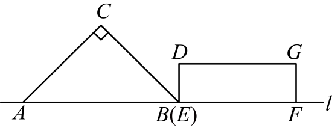

# Mathematics - 题目 612

**ID**: b66b435d31674d088d1e9eda28155f1e
**年级**: Grade 9
**难度**: Medium-Hard
**题型**: Multiple-choice

## 题目
如图，在 $\vartriangle ABC$ 中， $\angle C=90{}^\circ $ ， $AC=BC$ ． $AB$ 与矩形 $DEFG$ 的一边 $EF$ 都在直线 $l$ 上，其中 $AB=4$ 、 $DE=1$ 、 $EF=3$ ，且点 $B$ 位于点 $E$ 处．将 $\vartriangle ABC$ 沿直线，向右平移，直到点 $A$ 与点 $E$ 重合为止．记点 $B$ 平移的距离为 $x$ ， $\vartriangle ABC$ 与矩形 $DEFG$ 重叠区域面积为 $y$ ，则 $y$ 关于 $x$ 的函数图象大致为（      ）​​​​​​​‌

## 解答

1. 解：当 $BC$ 经过点 $D$ 时，如图所示：
2. 
3. $\because \vartriangle ABC$ 为等腰直角三角形，
4. $\therefore \angle DBE=45{}^\circ $ ，
5. $\because DE=1$ ， $\angle DEB=90{}^\circ $ ，
6. $\therefore EB=\frac {DE}{{\tan}45{}^\circ }=\frac {1}{1}=1$ ；
7. 当 $AC$ 经过点 $D$ 时，如图所示：
8. 
9. $\because \angle A=45{}^\circ $ ， $DE=1$ ，
10. $\therefore AE=1$ ，
11. $\therefore EB=AB-AE=4-1=3$ ；
12. ①当 $0\leqslant x\leqslant 1$ 时，如图所示：
13. 
14. 此时 $EB=x$ ， $\angle HBE=45{}^\circ $ ，
15. $\therefore HE={\tan}45{}^\circ \cdot EB=x$ ，
16. $\therefore y=\frac {1}{2}EB\cdot HE=\frac {1}{2}x\cdot x=\frac {1}{2}x{^{2}}$ ；
17. ②当 $1<x\leqslant 3$ 时，如图所示：
18. 
19. 过 $M$ 作 $MN⊥AB$ 于 $N$ ，
20. 此时， $MN=1$ ， $\angle MBN=45{}^\circ $ ，
21. $\therefore BN=1$ ，
22. $\because EB=x$ ，
23. $\therefore EN=EB-NB=x-1$ ，
24. $\because $ 四边形 $DENM$ 是矩形，
25. $\therefore DM=EN=x-1$ ，
26. $\therefore y=\frac {1}{2}(DM+EB)\cdot DE=\frac {1}{2}(x-1+x)\times 1=x-\frac {1}{2}$ ；
27. ③当 $3<x\leqslant 4$ 时，如图所示：
28. 
29. 此时 $IR=1$ ， $\angle IBR=45{}^\circ $
30. $\therefore BR=1$ ，
31. $\because EB=x$ ，
32. $\therefore ER=DI=x-1$ ， $AE=AB-EB=4-x$ ，
33. $\because \angle B=45{}^\circ $ ，
34. $\therefore TE=AE\cdot {\tan}45{}^\circ =4-x$ ，
35. $\because DE=1$ ，
36. $\therefore DT=DE-TE=1-(4-x)=x-3$ ，
37. $\because DG{\rm{/\mskip-4mu/}}AB$ ，
38. $\therefore \angle DKT=45{}^\circ $ ，
39. $\therefore DK=\frac {DT}{{\tan}45{}^\circ }=\frac {x-3}{1}=x-3$ ，
40. $\therefore y=S{{}_{四边形DERI}}+S{{}_{{\rm{Δ}}IRB}}-S{{}_{{\rm{Δ}}DTK}}=1\times \left ({x-1}\right )+\frac {1}{2}\times 1\times 1-\frac {1}{2}\times (x-3){^{2}}=-\frac {1}{2}x{^{2}}+4x-5$ ．
41. 故此题答案为D．

## 知识点

**中文**:
  - 矩形的性质
  - 解直角三角形
  - 等腰直角三角形的性质

**English**:
  - Properties of Rectangles
  - Solving Right Triangles
  - Properties of Isosceles Right Triangles

---
