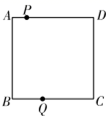

# Mathematics - 题目 893

**ID**: bc30b0b7a1244aacbf92485cfaecf150
**年级**: Grade 9
**难度**: Medium-Hard
**题型**: Multiple-choice

## 题目
如图，已知正方形 $ABCD$ 的边长为 $4cm$ ，动点 $P$ 从 $A$ 出发，沿 $AD$ 边以 $1cm/s$ 的速度运动，动点 $\mathbf{Q}$ 从 $B$ 出发，沿 $BC-CD$ 边以 $2cm/s$ 的速度运动，点 $P,Q$ 同时出发，运动到点 $D$ 时均停止运动．设运动时间为 $x$ (单位： $s$ )， $\vartriangle BPQ$ 的面积为 $y$ (单位： $cm{^{2}}$ )，则 $y$ 与 $x$ 之间的函数图象大致是（      ）​​​​​​​‌

## 解答

1. ①当 $0\leqslant x\leqslant 2$ 时，如下图：
2. 
3. 此时BQ= $2x$ ，
4. ∴ $y=\frac {1}{2}\times 4\times 2x=4x$ ，
5. ②当 $2\leqslant x\leqslant 4$ 时，如下图：
6. 
7. 此时PD= $4-x$ ，DQ= $8-2x$ ，CQ= $2x-4$ ，
8. ∴ $y=\frac {1}{2}\left ({4-x+4}\right )\times 4-\frac {1}{2}\times \left ({4-x}\right )\left ({8-2x}\right )-\frac {1}{2}\times 4\times \left ({2x-4}\right )=-x{^{2}}+2x+8$ ，
9. 综上所述， $y$ 与 $x$ 之间的函数关系可以用两段函数图象表示，纵观各个选项的图象只有选项B符合，
10. 故选：B.

## 知识点

**中文**:
  - 动点问题的函数图象
  - 图形问题
  - 待定系数法求一次函数解析式

**English**:
  - Graphs of Moving Point Problems
  - Geometric Problems
  - Finding Expressions by Undetermined Coefficients

---
