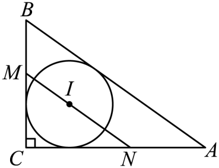

# Mathematics - 题目 2627

**ID**: c3ccdfd3df4c4c0eb4138c6f2f411378
**年级**: Grade 9
**难度**: Medium-Hard
**题型**: Multiple-choice

## 题目
如图 ${\rm ，}\odot I$ 是 ${\rm{R}}{\rm{t}}\mathrm{△}ABC$ 的内切圆 ${\rm ，}\angle ACB=90{}^\circ {\rm ，}$ 过点 ${\rm \mathit{I}}$ 作 $MN/\mskip-4mu/AB$ 分别交 $CA{\rm ，}$  $CB$ 于 ${\rm \mathit{N}，\mathit{M}}$ ，若 $BM=3{\rm ，}$  $AN=4{\rm ，}$ 则 $\odot I$ 的半径是（      ）​​​​​​​‌

## 解答

1. 解：设切点分别为 ${\rm \mathit{E}，\mathit{F}，\mathit{G}}$ ，连接 $IE{\rm ，}$  $IF{\rm ，}$  $IG{\rm ，}$ 过点 ${\rm \mathit{M}}$ 作 $MP\bot AB$ 于 ${\rm \mathit{P}}$ ，过点 ${\rm \mathit{N}}$ 作 $NQ\bot AB$ 于 ${\rm \mathit{Q}}$ ，
2. 
3. ∵ $\odot I$ 是 ${\rm{R}}{\rm{t}}\mathrm{△}ABC$ 的内切圆，
4. ∴ $IE\bot BC{\rm ，}$  $IF\bot AC{\rm ，}$  $IG\bot AB{\rm ，}$  $IE=IF=IG{\rm ，}$
5. ∵ $NQ\bot AB{\rm ，}$
6. ∴ $\angle AQN=\angle IFN=90{}^\circ {\rm ，}$
7. ∵ $MN/\mskip-4mu/AB{\rm ，}$
8. ∴ $\angle A=\angle INF{\rm ，}$
9. ∵ $MP\bot AB{\rm ，}$  $NQ\bot AB{\rm ，}$  $IG\bot AB{\rm ，}$  $MN/\mskip-4mu/AB{\rm ，}$
10. ∴ $NQ=IG=MP{\rm ，}$
11. ∴ $NQ=IF{\rm ，}$
12. ∴ $\vartriangle AQN≌\vartriangle NFI\left ({{\rm{A}}{\rm{A}}{\rm{S}}}\right ){\rm ，}$
13. ∴ $IN=AN=4{\rm ，}$
14. 同理可得 $IM=BM=3{\rm ，}$
15. ∵ $IE\bot BC{\rm ，}$
16. ∴ $\angle MEI=90{}^\circ {\rm ，}$
17. ∵ $\angle ACB=90{}^\circ $
18. ∴ $\angle MEI=\angle ACB$
19. ∴ $IE{\rm{/\mskip-4mu/}}AC{\rm ，}$
20. ∴ $\angle MIE=\angle INF{\rm ，}$
21. ∴ $\vartriangle MEI∽\vartriangle IFN{\rm ，}$
22. ∴ $\frac {ME}{IF}=\frac {IM}{IN}=\frac {3}{4}{\rm ，}$
23. 设 $ME=3x{\rm ，}$  $IF=4x{\rm ，}$ 则 $IE=IF=4x{\rm ，}$
24. 在 ${\rm{R}}{\rm{t}}\vartriangle MEI$ 中，由勾股定理，得
25. ${\left({3x}\right)^{2}}+{\left({4x}\right)^{2}}=3{^{2}}{\rm ，}$
26. 解得： $x=\frac {3}{5}{\rm ，}$
27. ∴ $IF=4x=\frac {12}{5}{\rm ，}$
28. 故此题答案为D．

## 知识点

**中文**:
  - 三角形内切圆
  - 平行线性质的应用
  - 相似三角形的判定与性质综合
  - 全等三角形的判定与性质

**English**:
  - Incircle of Triangle
  - Applications of Properties
  - Determination and Properties
  - Determination and Properties

---
