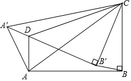

# Mathematics - 题目 1641

**ID**: ca68a1487608483daaac952e134e10d5
**年级**: Grade 9
**难度**: Medium-Hard
**题型**: Multiple-choice

## 题目
如图，在四边形ABCD中，AD∥BC，∠ABC＝90°，AB＝2 $\sqrt {7}$ ，AD＝2，将△ABC绕点C顺时针方向旋转后得△ $A^{′}B^{′}C$ ，当 $A^{′}B^{′}$ 恰好经过点D时，△ $B^{′}$ CD为等腰三角形，若B $B^{′}$ ＝2，则A $A^{′}$ ＝（      ）​​​​​​​‌

## 解答

1. 解：过 $D$ 作 $DE\bot BC$ 于 $E$ ，
2. 
3. 则 $\angle DEC=\angle DEB=90{}^\circ $ ，
4. $\because AD//BC$ ， $\angle ABC=90{}^\circ $ ，
5. $\therefore \angle DAB=\angle ABC=90{}^\circ $ ，
6. $\therefore $ 四边形 $ABED$ 是矩形，
7. $\therefore BE=AD=2$ ， $DE=AB=2\sqrt {7}$ ，
8. $\because $ 将 $ΔABC$ 绕点 $C$ 顺时针方向旋转后得△ $A\prime B\prime C$ ，
9. $\therefore \angle DB\prime C=\angle ABC=90{}^\circ $ ， $B\prime C=BC$ ， $A\prime C=AC$ ， $\angle A\prime CA=\angle B\prime CB$ ，
10. $\therefore $ △ $A\prime CA∽$ △ $B\prime CB$ ，
11. $\therefore $  $\frac {A\prime A}{B\prime B}=\frac {AC}{BC}$ ，
12. $\because $ △ $B\prime CD$ 为等腰三角形，
13. $\therefore $ △ $B\prime CD$ 为等腰直角三角形，
14. $\therefore CD=\sqrt {2}B\prime C$ ，
15. 设 $B\prime C=BC=x$ ，则 $CD=\sqrt {2}x$ ， $CE=x-2$ ，
16. $\because CD{^{2}}=CE{^{2}}+DE{^{2}}$ ，
17. $\therefore (\sqrt {2}x){^{2}}=(x-2){^{2}}+(2\sqrt {7}){^{2}}$ ，
18. $\therefore x=4$ （负值舍去），
19. $\therefore BC=4$ ，
20. $\therefore AC=\sqrt {AB{^{2}}+BC{^{2}}}=2\sqrt {11}$ ，
21. $\therefore $  $\frac {A\prime A}{2}=\frac {2\sqrt {11}}{4}$ ，
22. $\therefore A\prime A=\sqrt {11}$ ，
23. 故选： A  ．

## 知识点

**中文**:
  - 旋转的性质
  - 相似三角形的判定与性质综合
  - 等腰直角三角形的性质

**English**:
  - Properties of Rotation
  - Determination and Properties
  - Properties of Isosceles Right Triangles

---
