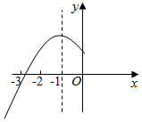

# Mathematics - 题目 3930

**ID**: cdbce5f172f649e5aced8b65a9dfae7d
**年级**: Grade 9
**难度**: Medium-Hard
**题型**: Multiple-choice

## 题目
二次函数y＝ax^{2}＋bx＋c（a≠0）的顶点坐标为（﹣1，n），其部分图象如图所示，下面结论错误的是（      ）​​​​​​​‌

## 解答

1. 解：A．∵抛物线开口向下，
2. ∴a＜0，
3. ∵对称轴为直线x＝﹣ $\frac {b}{2a}$ ＝﹣1，
4. ∴b＝2a＜0，
5. ∵抛物线与y轴交于正半轴，
6. ∴c＞0，
7. ∴abc＞0，
8. 故A正确；
9. B．∵抛物线与x轴有两个交点，
10. ∴b^{2}﹣4ac＞0，即4ac﹣b^{2}＜0，
11. 故B正确；
12. C．∵抛物线开口向下，顶点为（﹣1，n），
13. ∴函数有最大值n，
14. ∴抛物线y＝ax^{2}+bx+c与直线y＝n+1无交点，
15. ∴一元二次方程ax^{2}+bx+c＝n+1无实数根，
16. 故C正确；
17. D．∵抛物线的对称轴为直线x＝﹣1，抛物线与x轴的一个交点在（﹣3，0）和（﹣2，0）之间，
18. ∴抛物线与x轴的另一个交点在（0，0）和（1，0）之间，
19. ∴于x的方程ax^{2}+bx+c＝0的正实数根x_{1}取值范围为：0＜x_{1}＜1，
20. 故D错误；
21. 故选：D．

## 知识点

**中文**:
  - 二次函数的图象与系数之间的关系

**English**:
  - Relationship between Graphs and Coefficients

---
