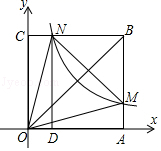

# Mathematics - 题目 3182

**ID**: d0565c84ba8d4a3fa6ecec777aa6c57a
**年级**: Grade 9
**难度**: Medium-Hard
**题型**: Multiple-choice

## 题目
如图，在平面直角坐标系中，正方形OABC的顶点O与坐标原点重合，顶点A、C分别在x轴、y轴上，反比例函数y= $\frac {k}{x}$ （k≠0，x＞0）的图象与正方形OABC的两边AB、BC分别交于点M、N，ND⊥x轴，垂足为D，连接OM、ON、MN，则下列选项中的结论错误的是（      ）​​​​​​​‌

## 解答

1. ∵点M、N都在y= $\frac {k}{x}$ 的图象上，
2. ∴S_{△ONC}=S_{△OAM}= $\frac {1}{2}$ k，即 $\frac {1}{2}$ OC•NC= $\frac {1}{2}$ OA•AM，
3. ∵四边形ABCO为正方形，
4. ∴OC=OA，∠OCN=∠OAM=90°，
5. ∴NC=AM，
6. ∴△OCN≌△OAM，
7. ∴A正确；
8. ∵S_{△OND}=S_{△OAM}= $\frac {1}{2}$ k，
9. 而S_{△OND}+S_{四边形}_{DAMN}=S_{△OAM}+S_{△OMN}，
10. ∴四边形DAMN与△MON面积相等，
11. ∴B正确；
12. ∵△OCN≌△OAM，
13. ∴ON=OM，
14. ∵k的值不能确定，
15. ∴∠MON的值不能确定，
16. ∴△ONM只能为等腰三角形，不能确定为等边三角形，
17. ∴ON≠MN，
18. ∴C错误；
19. 作NE⊥OM于E点，如图所示：
20. 
21. ∵∠MON=45°，∴△ONE为等腰直角三角形，
22. ∴NE=OE，
23. 设NE=x，则ON= $\sqrt {2}$ x，
24. ∴OM= $\sqrt {2}$ x，
25. ∴EM= $\sqrt {2}$ x-x=（  $\sqrt {2}$ -1）x，
26. 在Rt△NEM中，MN=2，
27. ∵MN^{2}=NE^{2}+EM^{2}，即2^{2}=x^{2}+[（  $\sqrt {2}$ -1）x]^{2}，
28. ∴x^{2}=2+ $\sqrt {2}$ ，
29. ∴ON^{2}=（ $\sqrt {2}$ x）^{2}=4+2 $\sqrt {2}$ ，
30. ∵CN=AM，CB=AB，
31. ∴BN=BM，
32. ∴△BMN为等腰直角三角形，
33. ∴BN= $\frac {\sqrt {2}}{2}$ MN= $\sqrt {2}$ ，
34. 设正方形ABCO的边长为a，则OC=a，CN=a- $\sqrt {2}$ ，
35. 在Rt△OCN中，∵OC^{2}+CN^{2}=ON^{2}，
36. ∴a^{2}+（a- $\sqrt {2}$ ）^{2}=4+2 $\sqrt {2}$ ，解得a_{1}= $\sqrt {2}$ +1，a_{2}=-1（舍去），
37. ∴OC= $\sqrt {2}$ +1，
38. ∴C点坐标为（0， $\sqrt {2}$ +1），
39. ∴D正确．
40. 故选：C．

## 知识点

**中文**:
  - 反比例函数的图象
  - 反比例函数的性质
  - 反比例函数系数k的几何意义及应用

**English**:
  - Graph of Inverse Proportionality Functions
  - Properties of Inverse Proportionality Functions
  - Geometric Meaning and Application of Coefficient k

---
