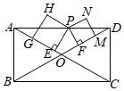

# Mathematics - 题目 311

**ID**: d1d8ba03d25b48fa8131784f25c77cd8
**年级**: Grade 9
**难度**: Medium-Hard
**题型**: Multiple-choice

## 题目
如图，在矩形 $ABCD$ 中， $AB=4$ ，对角线 $AC$ ， $BD$ 交于点 $O$ ， ${\sin}\angle COD=\frac {\sqrt {3}}{2}$ ， $P$ 为 $AD$ 上一动点， $PE\bot AC$ 于点 $E$ ， $PF\bot BD$ 于点 $F$ ，分别以 $PE$ ， $PF$ 为边向外作正方形 $PEGH$ 和 $PFMN$ ，面积分别为 $S{{}_{1}}$ ， $S{{}_{2}}$ ．则下列结论：① $BD=8$ ；​​​​​​​‌②点 $P$ 在运动过程中， $PE+PF$ 的值始终保持不变，为 $2\sqrt {3}$ ；③ $S{{}_{1}}+S{{}_{2}}$ 的最小值为6；④当 $PH:PN=5:6$ 时，则 $DM:AG=5:6$ ．其中正确的结论有（      ）

## 解答

1. 解：①∵ ${\sin}\angle COD=\frac {\sqrt {3}}{2}$ ，
2. ∴ $\angle COD=60{}^\circ $ ，
3. ∵四边形 $ABCD$ 是矩形，
4. ∴OA=OC=OD=OB，
5. ∴ $\vartriangle AOB$ 和 $\mathrm{△}COD$ 是等边三角形，
6. ∴BD=2OA=2AB=8，故①正确；
7. ②连接 $OP$ ，由①知 $BD=8$ ，
8. ∵矩形 $ABCD$ 的两边 $AB=4$ ， $BC=4\sqrt {3}$ ，
9. ∴ $S{{}_{矩形ABCD}}=AB\cdot BC=16\sqrt {3}$ ，
10. ∴ $S{{}_{\vartriangle AOD}}=\frac {1}{4}S{{}_{矩形ABCD}}=4\sqrt {3}$ ， $OA=OD=4$ ，
11. ∴ $S{{}_{\vartriangle AOD}}=S{{}_{\vartriangle AOP}}+S{{}_{\vartriangle DOP}}=\frac {1}{2}OA\cdot PE+\frac {1}{2}OD\cdot PF$  $=\frac {1}{2}OA\left ({PE+PF}\right )=\frac {1}{2}\times 4\times \left ({PE+PF}\right )=4\sqrt {3}$ ．
12. ∴ $PE+PF=2\sqrt {3}$ ，故②正确；
13. ③∵ ${\left({PE-PF}\right)^{2}}=PE{^{2}}+PF{^{2}}-2PE\cdot PF\geqslant 0$ ，
14. ∴ $PE{^{2}}+PF{^{2}}\geqslant 2PE\cdot PF$ ，
15. ∴ $S{{}_{1}}+S{{}_{2}}=PE{^{2}}+PF{^{2}}=\frac {1}{2}\left ({PE{^{2}}+PF{^{2}}+PE{^{2}}+PF{^{2}}}\right )$  $\geqslant \frac {1}{2}\left ({PE{^{2}}+PF{^{2}}+2PE\cdot PF}\right )=\frac {1}{2}{\left({PE+PF}\right)^{2}}=6$ ，
16. 当且仅当 $PE=PF=\sqrt {3}$ 时，等号成立，故③正确；
17. ④∵∠AEP=∠DFP，∠PAE=∠PDF，
18. ∴ $△APE\sim △DPF$ ，
19. ∴AE：DF=PE：PF=EG：FM=PH：PN=5：6,
20. ∵AE:DF=(AG+GE):（DM+FM）,
21. ∴AG：DM=5：6,，故④错误．
22. 综上所述，其中正确的结论有①②③，3个．
23. 故选：C．

## 知识点

**中文**:
  - 完全平方公式
  - 矩形的性质
  - 相似三角形的判定与性质综合
  - 特殊角的三角函数值

**English**:
  - Perfect Square Formula
  - Properties of Rectangles
  - Determination and Properties
  - Trigonometric Values of Special Angles

---
