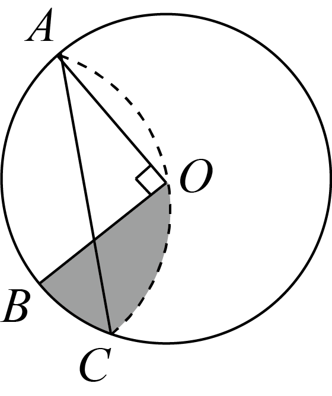

# Mathematics - 题目 2802

**ID**: d24c64c09133492e99ca4fd54a1970cf
**年级**: Grade 9
**难度**: Medium-Hard
**题型**: Multiple-choice

## 题目
如图是一张圆心为O，半径为4cm的圆形纸片，沿弦AC所在直线折叠，使得 $\overset ⌢{{AC}}$ 经过点O，将纸片 $\odot O$ 展平后，作半径 $OB\bot OA$ ，则图中阴影部分的面积等于（      ）​​​​​​​‌

## 解答

1. 作OD⊥AC交圆于点D，交AC于点E，连接OC，如图，
2. 
3. ∴OD垂直平分弦AC，平分 ${\rm \overset ⌢{{ADC}}}$  和 ${\rm \overset ⌢{{AOC}}}$ ，
4. ∵AC是 ${\rm \overset ⌢{{ADC}}}$ 向圆内的折线，且弦AC折叠后经过点O，
5. ∴点O是点D关于AC的对称点，即OD与AC互相垂直平分，
6. ∴OE=DE= $\frac {1}{2}$OD
7. 设 ${\rm \overset ⌢{{ADC}}}$ 与弦AC构成的图形面积为SADC， ${\rm \overset ⌢{{ADC}}}$ 与 ${\rm \overset ⌢{{AOC}}}$ 构成的图形面积为SADCO， ${\rm \overset ⌢{{DBC}}}$ 与 ${\rm \overset ⌢{{OC}}}$ 和线段OD构成的图形面积为SODC，
8. 则SADC_{=}$\frac {1}{2}$SADCO，SODC_{=}$\frac {1}{2}$SADCO，
9. ∴SODC=SADC，
10. ∵OD、OA都是圆O的半径，半径为4cm，
11. ∴OE= $\frac {1}{2}$OD= $\frac {1}{2}$OA= $\frac {1}{2}\times 4=2{\rm{c}}{\rm{m}}$ ，
12. ∴∠OAE=30°，
13. ∴∠AOE=90°-30°=60°，
14. ∴∠AOC=2∠AOE=2×60°=120°，
15. ∴S_{扇形}OAC= $\frac {120{}^\circ }{360{}^\circ }πr{^{2}}$ = $\frac {1}{3}π\times 4{^{2}}=\frac {16}{3}π$ (cm^{2})，
16. ∵AC=2AE= ${\rm 2\sqrt {OA{^{2}}-OE{^{2}}}=2\sqrt {4{^{2}}-2{^{2}}}=4\sqrt {3}}$ cm，
17. ∴S_{△}OAC= ${\rm \frac {1}{2}AC\times OE=\frac {1}{2}\times 4\sqrt {3}\times 2=4\sqrt {3}}$ (cm^{2})，
18. ∴SADC=S_{扇形}OAC-S_{△}OAC=（ $\frac {16}{3}π-4\sqrt {3}$ ）(cm^{2})，
19. ∴SODC=（ $\frac {16}{3}π-4\sqrt {3}$ ）(cm^{2})，
20. ∵OB⊥OA，∠AOE=60°，
21. ∴∠BOD=∠AOB-∠AOE=90°-60°=30°，
22. ∴S_{扇形}OBD= $\frac {30{}^\circ }{360{}^\circ }πr{^{2}}=\frac {1}{12}π\times 4{^{2}}=\frac {4}{3}π$ (cm^{2})，
23. ∴S_{阴影}=SODC-S_{扇形}OBD= $\frac {16}{3}π-4\sqrt {3}-\frac {4}{3}π$ =（ $4π-4\sqrt {3}$ ）(cm^{2})，
24. 故选 A．

## 知识点

**中文**:
  - 垂径定理及其推论
  - 扇形面积的计算
  - 折叠问题

**English**:
  - Perpendicular Chord Theorem
  - Sector Area Calculation
  - Folding Problems

---
