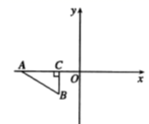

# Mathematics - 题目 3540

**ID**: d2aacc3cfc1d4850ac329aaff7866963
**年级**: Grade 9
**难度**: Medium-Hard
**题型**: Multiple-choice

## 题目
如图，在平面直角坐标系中，点 $A,C$ 在 $x$ 轴上，点 $C$ 的坐标为 $(-1,0),AC=2$ .​​​​​​​‌将 $Rt\Delta ABC$ 先绕点 $C$ 顺时针旋转90°，再向右平移3个单位长度，则变换后点 $A$ 的对应点坐标是（      ）

## 解答

1. 将 $Rt\Delta ABC$ 先绕点 $C$ 顺时针旋转90°，得到点坐标为 $A^{′}$ (-1,2),再向右平移3个单位长度，则 $A^{′}$ 点的纵坐标不变，横坐标加上3个单位长度，故变换后点 $A$ 的对应点坐标是 $A^{′′}$ (2,2).

## 知识点

**中文**:
  - 图形的平移

**English**:
  - Translation of Figures

---
