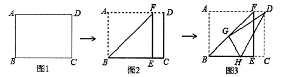

# Mathematics - 题目 3966

**ID**: d30d73dbe0d041f7827d23c981c84e47
**年级**: Grade 9
**难度**: Medium-Hard
**题型**: Multiple-choice

## 题目
如图1，有一张矩形纸片 $ABCD,$ 已知 $AB=10,AD=12,$ 现将纸片进行如下操作:现将纸片沿折痕 $BF$ 进行折叠，使点 $A$ 落在 $BC$ 边上的点 $E$ 处，点 $F$ 在 $AD$ 上(如图2)；​​​​​​​‌然后将纸片沿折痕 $DH$ 进行第二次折叠，使点 $C$ 落在第一次的折痕 $BF$ 上的点 $G$ 处，点 $H$ 在 $BC$ 上(如图3)，给出四个结论：① $AF$ 的长为 $10$ ；② $\vartriangle BGH$ 的周长为 $18;$ ③ $\frac {BG}{GF}=\frac {2}{3}$ ；④ $GH$ 的长为 $5,$ 其中正确的结论有（      ）

## 解答

1. 解：如图，过点G作MN∥AB，分别交AD、BC于点M、N，
2. 
3. ∵四边形ABCD为矩形，
4. ∴AB=CD=10，BC=AD=12，
5. 由折叠可得AB=BE，且∠A=∠ABE=∠BEF=90°，
6. ∴四边形ABEF为正方形，
7. ∴AF=AB=10，
8. 故①正确；
9. ∵MN∥AB，
10. ∴△BNG和△FMG为等腰直角三角形，且MN=AB=10，
11. 设BN=x，则GN=AM=x，MG=MN-GN=10-x，MD=AD-AM=12-x，
12. 又由折叠的可知DG=DC=10，
13. 在Rt△MDG中，由勾股定理可得MD^{2}+MG^{2}=GD^{2}，
14. 即（12-x）^{2}+（10-x）^{2}=10^{2}，解得x=4，
15. ∴GN=BN=4，MG=6，MD=8，
16. 又∠DGH=∠C=∠GMD=90°，
17. ∴∠NGH+∠MGD=∠MGD+∠MDG=90°，
18. ∴∠NGH=∠MDG，且∠DMG=∠GNH，
19. ∴△MGD∽△NHG，
20. ∴ $\frac {MD}{GN}=\frac {MG}{NH}=\frac {DG}{GH}$ ，即 $\frac {8}{4}=\frac {6}{NH}=\frac {10}{GH}$ ，
21. ∴NH=3，GH=CH=5，
22. ∴BH=BC-HC=12-5=7，
23. 故④正确；
24. 又△BNG和△FMG为等腰直角三角形，且BN=4，MG=6，
25. ∴BG= $4\sqrt {2}$ ，GF= $6\sqrt {2}$ ，
26. ∴△BGH的周长=BG+GH+BH= $4\sqrt {2}$ +5+7=12+ $4\sqrt {2}$ ，
27. ∴ $\frac {BG}{GF}=\frac {4\sqrt {2}}{6\sqrt {2}}=\frac {2}{3}$ ，
28. 故②不正确；③正确；
29. 综上可知正确的为：①③④，
30. 故选：C．

## 知识点

**中文**:
  - 正方形的判定与性质综合
  - 矩形的性质
  - 相似三角形的判定与性质综合

**English**:
  - Determination and Properties of Squares
  - Properties of Rectangles
  - Determination and Properties

---
