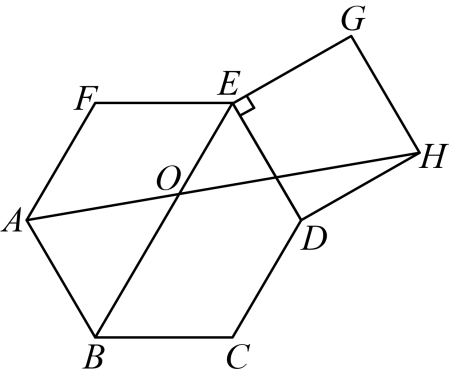

# Mathematics - 题目 386

**ID**: d68fb03c7f93483490f5fa79b84679be
**年级**: Grade 9
**难度**: Medium-Hard
**题型**: Multiple-choice

## 题目
如图，正六边形 $ABCDEF$ 外作正方形 $DEGH$ ，连接 $AH{\rm{、}}BE$ 交于点O，求 $\frac {EO}{BO}$ 的值（      ）​​​​​​​‌

## 解答

1. 解：如图， $AH$ 交 $ED$ 于点N，连接 $BD$ ，过点C作 $CM\bot BD$ 于点M，
2. 
3. 设正六边形的边长为a，则 $AB=BC=CD=DE=a$ ，
4. $\because $ 六边形 $ABCDEF$ 是正六边形，
5. $\therefore \angle BCD=\angle CDE=\frac {\left ({6-4}\right )\times 180{}^\circ }{6}=120{}^\circ $ ，
6. $\therefore \angle CBD=\angle CDB=30{}^\circ $ ，
7. $\therefore \angle EDB=90{}^\circ {\rm{，}}BM=BC\cdot {\sin}\angle CBM=\frac {\sqrt {3}}{2}a，DM=CD\cdot {\sin}\angle CDM=\frac {\sqrt {3}}{2}a$ ，
8. $\therefore BD=\sqrt {3}a$ ，
9. 同理可得 $\angle ABD=90{}^\circ $ ，
10. ∵四边形 $EDHG$ 是正方形，
11. $\therefore \angle EDH=90{}^\circ $ ，
12. $\therefore B$ 、H、D三点共线，
13. $\because ND{\rm{/\mskip-4mu/}}AB$ ，
14. $\therefore \frac {NH}{NA}=\frac {ND}{AB}=\frac {DH}{BD}=\frac {a}{\sqrt {3}a}=\frac {\sqrt {3}}{3}$ ，
15. $\therefore ND=\frac {\sqrt {3}}{3}a$ ，
16. $\because ED{\rm{/\mskip-4mu/}}AB$ ，
17. $\therefore \vartriangle EON∽\vartriangle BOA$
18. $\therefore \frac {EO}{BO}=\frac {EN}{AB}=\frac {ED-ND}{AB}=\frac {a-\frac {\sqrt {3}}{3}a}{a}=\frac {3-\sqrt {3}}{3}$ ，
19. 故此题答案为A．

## 知识点

**中文**:
  - 正多边形的概念和性质
  - 相似三角形的判定与性质综合
  - 解直角三角形

**English**:
  - Regular Polygons Concepts
  - Determination and Properties
  - Solving Right Triangles

---
