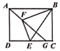

# Mathematics - 题目 1719

**ID**: da2e67fc777e455abdbfa62649d511b0
**年级**: Grade 9
**难度**: Medium-Hard
**题型**: Multiple-choice

## 题目
如图所示，已知矩形ABCD，AB=4，AD=3，点E为边DC上不与端点重合的一个动点，连接BE，将BCE沿BE翻折得到BEF，连接AF并延长交CD于点G，则线段CG的最大值是（      ）​​​​​​​‌

## 解答

1. 由图可知：DG最小时CG最大，故当∠GAD最小（∠GAB最大）时，CG取最大值，
2. ∵F在以B为圆心，BC为半径的圆上，
3. ∴AF与圆相切时，∠GAB最大，
4. 即AF⊥BF，此时点G、E重合，
5. ∵AB∥CD，
6. ∴∠BAF=∠AED，
7. ∵∠AFB=∠D=90°，BF=BC=AD,
8. ∴△ABF≌△AED，
9. ∴AE=AB=4，
10. ∴DE= $\sqrt {AE{^{2}}-AD{^{2}}}=\sqrt {4{^{2}}-3{^{2}}}=\sqrt {7}$ ，
11. ∴CE=CG= $4-\sqrt {7}$ ,
12. 故选：D.
13. 

## 知识点

**中文**:
  - 全等三角形实际应用
  - 勾股定理的应用
  - 矩形的性质
  - 切线的性质定理

**English**:
  - Applications of Congruent Triangles
  - Applications of Pythagorean Theorem
  - Properties of Rectangles
  - Tangent Properties Theorem

---
